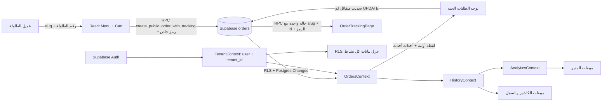

# SERVIO — الدليل الموحد للمشروع

> **المصدر الأساسي للتوثيق:** هذا الملف يجمع وصف المنتج، البنية التقنية، التشغيل، الطباعة والضريبة، الهوية، المهام المسلّمة، وملاحظات الصيانة. بعد موافقة صاحب المستودع في 2026-10-19، حُذفت ملفات التوثيق الأصلية التي دُمج محتواها هنا ونسخة JSON المكررة المحددة في سجل التدقيق.
>
> **آخر مراجعة للمستودع:** 2026-10-19. الوثيقة تصف الكود والتهيئة المسجلة في Git وتوضح حدود ما جرى اختباره؛ لا تعني اعتمادًا ضريبيًا أو قانونيًا أو توافقًا مع كل طابعة.

## فهرس الدليل

- [ملخص المشروع بالإنجليزية](#section-project-overview-en)
- [دليل التطوير المختصر](#section-development-index)
- [حالة الميزات وحدود الاختبار](#section-current-status)
- [المعمارية والتطوير والترحيلات](#section-development-guide)
- [POS وVAT والطباعة](#section-pos-vat)
- [إعداد الطابعات](#section-printer-operations)
- [الهوية](#section-brand-directions)
- [المراجع الرسمية](#section-tax-sources)
- [إشعارات المكونات الخارجية](#section-third-party-notices)
- [إعداد Windows](#section-windows-printer-install)
- [وظيفة دخول الكاشير](#section-cashier-edge-function)
- [ملفات المثال والتراخيص](#preserved-non-document-artifacts)
- [تقرير التدقيق والاختبارات](#repository-audit-2026-10-19)

## ملفات الإعداد والأصول التي تبقى منفصلة عن هذا الدليل

هذه الملفات ليست نثرًا توثيقيًا قابلًا للدمج: `package.json` و`package-lock.json` و`.env.example` وملفات JSON النموذجية مطلوبة للأدوات أو التشغيل، وملفات الشهادة/المفتاح لها معنى تشفيري، والصور والرموز وملفات ZIP أصول نشر. نسخة LGPL الكاملة يجب أن تبقى كملف ترخيص مستقل. لا تُضاف تعليقات إلى JSON أو الملفات الثنائية لأنها ستكسرها أو تغيّر أصلها.

---


<a id="section-project-overview-en"></a>

# ملخص المشروع — النص الأصلي للـREADME بالإنجليزية

#  SERVIO

> ## **Serve faster. Operate smarter. Grow with every table.**
>
> SERVIO is a Saudi FoodTech platform that helps cafés and restaurants modernize table ordering and daily operations through QR-powered experiences.

<p align="left">
  
  
  
  
</p>

SERVIO connects guests, service teams, and managers through QR-based table ordering, real-time operations, and practical business insights. A guest scans a table QR code, browses the menu, places an order, requests a waiter, and leaves feedback — without downloading an app. Managers and cashiers receive live updates through a focused Arabic-first dashboard built for hospitality operations.

> **Current focus:** validating the need, demand, and market fit in Saudi Arabia before formal company registration and incubation applications.

## At a glance

| | |
|---|---|
| **Category** | Saudi FoodTech / Hospitality SaaS |
| **Stage** | Initial experimental MVP · Pre-incubation |
| **Primary market** | Saudi Arabia |
| **Experience** | Arabic-first · RTL · Responsive |
| **Access model** | Guest QR access + manager/cashier dashboards |
| **Commercial status** | Private product · Proprietary |

## Contents

- [Why SERVIO](#why-servio)
- [Product experience](#product-experience)
- [Product capabilities](#product-capabilities)
- [Technical architecture](#technical-architecture)
- [Local development](#local-development)
- [Email verification](#email-verification)
- [Security and performance](#security-and-performance)
- [Roadmap](#roadmap)
- [Team](#team)
- [Contact](#contact-and-links)
- [Commercial and licensing status](#commercial-and-licensing-status)

---

## Why SERVIO

Cafés and restaurants lose time and revenue when ordering, waiter requests, and operational follow-up depend on fragmented tools or manual communication.

SERVIO brings the core workflow into one system:

- **Faster ordering:** customers order directly from their table.
- **Better service:** waiter calls and new orders reach the team in real time.
- **Clearer operations:** managers and cashiers work from tenant-scoped dashboards.
- **More useful feedback:** customer reviews are collected and surfaced to management.
- **Lower friction:** no customer account or mobile app is required.

## Product experience

```text
Guest scans QR → Browses menu → Orders from table → Team receives live alert
                                                          ↓
                                      Manager tracks operations and improves service
```

## Product capabilities

### Guest experience

- QR-based menu access by café slug and table number.
- Arabic-first, responsive menu experience with RTL layout.
- Menu categories, search, item details, allergens, tags, and recommendations.
- Cart and table-specific order placement.
- One-tap waiter calls and bill/service requests.
- Customer ratings and feedback.

### Manager and cashier operations

- Separate manager and cashier access.
- Supabase Auth for manager accounts.
- Tenant-scoped cashier login using café slug, username, and PIN.
- Cashier management from the settings area.
- Live order updates and waiter-call notifications.
- Browser notification sounds for new orders and waiter calls.
- Order status workflow and order history.
- Menu item and category CRUD.
- Store profile, branding, currency, and café slug management.
- Table generation and printable QR cards.
- Analytics and feedback views.
- Secure sign-out for managers and cashiers.

### QR and table operations

Each generated QR code points to the canonical table URL:

```text
/menu/{cafe-slug}/{table-number}
```

QR cards use high error correction and can be printed individually or in bulk.

## Product status

**Current stage:** Initial experimental MVP / pre-incubation validation.

SERVIO is not yet formally registered as a company. The team is currently validating the need, user demand, and market fit in Saudi Arabia before applying to an incubator and proceeding with formal registration.

The current repository includes the core ordering, tenant isolation, authentication, realtime operations, QR, RTL, and manager workflow foundations. A public production launch still requires environment configuration, reliable email delivery, deployment setup, legal/commercial decisions, and full end-to-end acceptance testing with real cafés and restaurants.

## Technical architecture

```text
Guest browser
    │
    ├── QR menu and table route
    ├── Public tenant-safe RPCs
    └── Order / waiter call / feedback actions
            │
            ▼
React application ── Supabase Auth
    │                    │
    ├── Manager dashboard │
    ├── Cashier dashboard │
    ├── Tenant context    │
    └── Realtime channels │
                         ▼
                 PostgreSQL + RLS
                 tenants, menu, tables,
                 orders, waiter calls,
                 feedback, profiles, cashiers
```

### Main stack

- **Frontend:** React 18, React Router, Material UI.
- **Backend:** Supabase PostgreSQL, Auth, RPCs, Realtime, Edge Functions.
- **Data isolation:** tenant IDs, PostgreSQL Row Level Security, scoped policies.
- **Realtime:** Supabase Broadcast with Postgres Changes fallback.
- **QR:** `qrcode.react`.
- **Language and layout:** Arabic-first UI with global RTL support.
- **Build tooling:** Create React App / `react-scripts`.

## Repository structure

```text
src/
├── components/                 Reusable UI and dashboard components
├── context/                    Tenant, auth-adjacent, menu, orders, tables, and realtime state
├── pages/                      Menu, login, registration, and dashboard screens
├── theme/                      Material UI theme and RTL configuration
├── utils/                      Image compression, notifications, and logout helpers
└── supabase.js                 Browser Supabase client

supabase/
├── functions/cashier-login/    Secure cashier session Edge Function
└── migrations/                 Tenant, RLS, auth, realtime, and performance migrations

public/                         Static assets and optimized logo files
```

## Local development

### Requirements

- Node.js 18+ recommended.
- npm 9+ recommended.
- A Supabase project with the required migrations applied.

### Installation

PowerShell:

```powershell
git clone https://github.com/Servio-Tech/servio-v01.git
cd servio-v01
npm ci
Copy-Item .env.example .env
notepad .env
npm start
```

macOS / Linux:

```bash
git clone https://github.com/Servio-Tech/servio-v01.git
cd servio-v01
npm ci
cp .env.example .env
nano .env
npm start
```

The development server runs at:

```text
http://localhost:3000
```

## Environment variables

The browser app requires only the public Supabase configuration:

```env
REACT_APP_SUPABASE_URL=https://your-project.supabase.co
REACT_APP_SUPABASE_KEY=your_supabase_anon_or_publishable_key
```

Use the public **anon / publishable** key only. Never put the following in the frontend `.env` file:

- Supabase `service_role` key.
- Database password.
- Any private server secret.

`.env` is intentionally ignored by Git. `.env.example` is the safe, tracked template.

## Email verification

Manager registration uses Supabase Auth email sign-up with a redirect back to `/login`.

When **Confirm email** is enabled in Supabase Auth:

1. The manager submits the registration form.
2. SERVIO creates the tenant and sends an activation email.
3. SERVIO shows a verification screen.
4. The manager can resend the activation email.
5. The manager confirms the email and then signs in.

Configure in Supabase:

- **Authentication → Providers → Email → Confirm email:** enabled.
- **Authentication → URL Configuration → Site URL:** the production URL.
- **Redirect URLs:** include the local and production login URLs.

## Supabase and deployment notes

Before deploying a new environment:

1. Configure the project URL and public key.
2. Apply the migrations in `supabase/migrations/`.
3. Deploy the `cashier-login` Edge Function.
4. Configure Supabase Auth email confirmation and redirect URLs.
5. Configure an SMTP provider for reliable production email delivery.
6. Run manager, cashier, guest ordering, QR, realtime, and sign-out acceptance tests.

## Available scripts

```bash
npm start          # Start the development server
npm run build      # Create a production build
npm test           # Run the test runner
```

## Security and performance

- Every business record is associated with a tenant.
- RLS policies restrict authenticated access to the current tenant.
- Public menu operations use dedicated tenant-aware RPCs.
- Cashier PINs are verified server-side and are not stored as plain text.
- Service-role credentials must remain server-side.
- Sign-out clears both the Supabase session and the local cashier marker.

## Performance work included

- Optimized static logo asset in WebP format.
- Client-side compression for uploaded menu and café images.
- Tenant and foreign-key indexes for common database access paths.
- Narrow tenant-scoped queries in dashboard contexts.
- Realtime subscriptions cleaned up when dashboard contexts unmount.

## Roadmap

> The roadmap below is a product planning draft and should be confirmed by the SERVIO team.

- Production deployment pipeline and preview environments.
- Automated unit, integration, and end-to-end tests.
- Receipt printing and POS integrations.
- Payment and online settlement integrations.
- Multi-branch organization management.
- Staff roles and permissions beyond manager/cashier.
- Inventory and procurement workflows.
- Deeper analytics and exportable reports.
- Push notifications and mobile staff experience.

## Contributing

1. Create a feature branch from `main`.
2. Keep tenant isolation and RLS behavior intact.
3. Do not commit `.env`, service-role keys, or customer data.
4. Run `npm run build` before opening a pull request.
5. Describe the user impact and database impact of each change.

## Team

### Mohamed Elhag Mohamed Eshag — Founder, CEO & Tech Lead

Mohamed is SERVIO's principal founder and leads product direction, technical strategy, and frontend engineering.

- GitHub: [codemo-dev](https://github.com/codemo-dev)
- LinkedIn: [Mohamed Eshag](https://www.linkedin.com/in/codemo-dev)
- Portfolio: [codemo-dev.netlify.app](https://codemo-dev.netlify.app/)
- X: [@MohamedEshagx](https://x.com/MohamedEshagx)
- Email: [mohamed.eshagx@gmail.com](mailto:mohamed.eshagx@gmail.com)

### Amin Ehab Ahmed Bakhit — Co-founder & COO

Amin is a co-founder responsible for operations, execution, and helping shape SERVIO's path from product validation to market readiness.

- LinkedIn: [Amin Bakhit](https://www.linkedin.com/in/amin-servio-3a9249438)
- Email: [aminservio@gmail.com](mailto:aminservio@gmail.com)

### Mujahid Abbas Alhassan Alamin — Co-founder & CMO

Mujahid leads marketing direction, brand development, and go-to-market preparation as SERVIO validates its position in the Saudi hospitality market. His public profile and contact details will be added after confirmation.

## Contact and links

- Product stage: Initial experimental MVP / pre-incubation
- Primary market: Saudi Arabia
- Product website: [Servio MVP](https://servio-mvp.vercel.app/)
- Support and general contact: [servio.app.sa@gmail.com](mailto:servio.app.sa@gmail.com)
- Company LinkedIn: [SERVIO Tech](https://www.linkedin.com/company/servio-tech)
- Company X: [@servioApp](https://x.com/servioApp)
- Repository: [Servio-Tech/servio-v01](https://github.com/Servio-Tech/servio-v01)


## Commercial and licensing status

SERVIO is **not open source** at this stage. The repository is a private product codebase intended for the founding team and authorized collaborators. Until the company is formally registered and its intellectual-property ownership is documented, the safest practical position is to keep the repository private and use a **proprietary / all-rights-reserved** notice.

This README is product documentation, not legal advice. Before public launch or onboarding external contributors, the team should confirm ownership, founder IP assignment, contributor agreements, privacy terms, customer terms, and the final commercial license with a qualified lawyer in Saudi Arabia.

## License

**Proprietary — All rights reserved.**

No permission is granted to copy, modify, distribute, sublicense, or use this software commercially without written permission from SERVIO's authorized owners. This notice should be reviewed and formalized when the company is registered.


<a id="section-development-index"></a>

# دليل التطوير المختصر

# دليل تطوير SERVIO

هذا الملف هو المدخل السريع إلى توثيق النسخة الأولى. الدليل المعماري الكامل ومسارات العمل وربط Supabase وخطة النسخة الثانية موجود في:

- [`docs/DEVELOPMENT_GUIDE_AR.md`](#section-development-guide)
- [`docs/CASHIER_POS_VAT_AR.md`](#section-pos-vat) — شرح البيع المكتمل من POS، تفصيل VAT، الطباعة وحدودها، وسياسة RLS.
- [`docs/SOURCES_CASHIER_VAT_AR.md`](#section-tax-sources) — مصادر هيئة الزكاة والضريبة والجمارك ومرجع الطباعة الرسمي من MDN.

اتجاهات الهوية الأحدث ومعنى كل شعار والاختيار المطبق موثقة في [`docs/SERVIO_BRAND_DIRECTIONS_AR.md`](#section-brand-directions).

## أبرز ما يغطيه الدليل الموسع

- ترتيب مزودي الحالة والمسارات والأدوار.
- رحلة الطلب من QR حتى Realtime وتحديث الحالة والفاتورة.
- واجهة POS للكاشير التي تسجل المبيعات مكتملة مباشرة، ومسار طلب الطاولة، وحساب الضريبة الشاملة 15/115.
- حساب المبيعات من `total_price` وتاريخ الإكمال، وأسباب ظهور الصفر أثناء التحميل.
- مسؤولية كل ملف ومجلد أساسي.
- جلسات Supabase و`tenant_id` وRLS وRPC والمفاتيح التي لا يجوز كشفها.
- الترحيلات الموجودة وكيفية إضافة تغيير قاعدة بيانات آمن.
- اختبارات يدوية وخطة منظمة للنسخة الثانية.
- ثلاثة تصورات لأيقونة SERVIO مع سبب اختيار الأيقونة الحالية للمتصفح.

## موضع التعليقات العربية

التعليقات التفصيلية موجودة في الملفات المحورية التي تحمل منطق الخدمة: `OrdersContext.jsx`, `HistoryContext.jsx`, `AnalyticsContext.jsx`, `TenantContext.jsx`, `UserContext.jsx`, `App.js`, و`index.js`. كما تشرح التعليقات العربية الجديدة عزل سلة الكاشير وحالة الطلب وقرار الأسعار الشاملة للضريبة في `CashierPOSPage.jsx` و`taxUtils.js`. بقية الواجهات والوحدات موثقة حسب مسؤوليتها في الدليل الموسع بدل إضافة تعليق حرفي على كل سطر.

## تغييرات الإصلاحات الأخيرة

- تبسيط محتوى الطلبات في قاعدة البيانات إلى لقطة الصنف المطلوبة للفواتير والتحليلات.
- إصلاح ترتيب جلب بيانات الطلبات بعد تحديد النشاط، ومصالحة REST مع أحداث Realtime.
- تحسين تحديث حالة الطلب وإعادة المحاولة للأخطاء المؤقتة.
- عرض حالة التحميل/الفشل بدل إجمالي مبيعات صفري مضلل.
- توحيد اسم المتصفح وPWA وأيقونة SERVIO وألوانها.
- مزامنة أصناف وفئات المنيو الخاصة بلوحة المدير بين أجهزته عبر Broadcast خفيف خاص بالمستأجر، مع إعادة جلب عند فتح تبويب المنيو أو عودة الاتصال.
- عدم بث الصورة الكبيرة المخزنة مع كل صنف؛ أحداث المزامنة ترسل اسم الجدول ومعرف الصف والعملية فقط، وسياسة Realtime تقيد القناة بنشاط المستخدم المسجل.
- توسيع علامة SERVIO لتناسب قطاعات الخدمات والضيافة، وتطبيق الرمز الجديد في favicon وPWA والرموز الاحتياطية.
- إضافة نقطة بيع كاملة للكاشير بشبكة أزرار قابلة للمس؛ تحفظ البيع مكتملًا وتضيفه للسجل ومبيعات اليوم دون إرساله للمطبخ.
- إضافة زر إعداد/اختبار الطابعة واستدعاء طباعة النظام تلقائيًا بعد حفظ POS، مع إبقاء إعادة الطباعة اليدوية وتوثيق حدود المتصفح.
- إظهار VAT السعودي المضمنة 15% على فواتير POS والطاولة وملخص سلة الطاولة دون رفع الإجمالي، مع توثيق رسمي وحدود عدم التكامل مع «فاتورة».
- إصلاح رفض `POST /rest/v1/orders` بـ403 عبر سياسة INSERT لـ`authenticated` محصورة في `tenant_match(tenant_id)`؛ لا تمنح الضيف ولا تعطل RLS.


<a id="section-current-status"></a>

# المهام المسلّمة وحدود التحقق

# خطة تطوير الكاشير والطباعة

## 1. حالة الدفع للطلبات
- [x] إضافة حالة دفع محفوظة للطلب، مع قيمة افتراضية «غير مدفوع» للطلبات الجديدة وحفظ حالة الدفع وتاريخها عند التعديل.
- [x] تمكين موظف الكاشير من تحديد «مدفوع» أو «غير مدفوع» من بطاقة الطلب الوارد، وتمكين الكاشير من تحديدها في البيع المباشر.
- [x] إتاحة اختيار طريقة الدفع مستقلًا عن حالته (نقدًا، بطاقة/شبكة «مدى»، محفظة رقمية، تحويل بنكي، أخرى) في الطلب الوارد وواجهة POS وحفظها وإظهارها في الفاتورة؛ تبقى غير محددة حتى يختارها الموظف.
- [x] إظهار حالة الدفع في فاتورة الكاشير، مع إبقاء الطلبات التاريخية التي لا تحمل هذه المعلومة «غير محددة» بدل تغيير تاريخها المالي.

## 2. أنواع الإيصالات والطابعات
- [x] تصحيح اتصال الحروف العربية في مخرجات QZ Tray باستخدام عرض المتصفح ثم PNG/Pixel، مع دعم مقاسي 58 و80 مم وA4.
- [x] تقديم إيصال كاشير كامل يتضمن شعار المحل المحفوظ في إعدادات النشاط، الأسعار والضريبة 15/115 والإجمالي وحالة الدفع وطريقته.
- [x] تقديم تذكرة مطبخ منفصلة لا تحتوي أسعارًا أو إجماليات، وتعرض رقم الطلب والطاولة والأصناف والكميات والإضافات وملاحظات الطلب فقط.
- [x] الحفاظ على تقسيم الإيصالات حسب التصنيف وإتاحة توجيه كل تصنيف مفعّل إلى طابعة؛ تكون أسماء الطابعات محفوظة محليًا لكل جهاز كاشير لأن QZ Tray يعمل على الجهاز نفسه.
- [x] تحسين واجهة إعداد الطابعات، وإتاحة فتحها من شاشة الطلبات الواردة، دون فرض طباعة تلقائية لتذكرة المطبخ أو تغيير إعداد الطباعة التلقائية الحالي.

## 3. سهولة استخدام POS على الشاشات الضيقة
- [x] عرض أسماء الأصناف وتفاصيلها بوضوح وبخط أثقل، وتقليل أعمدة الأصناف حسب عرض الشاشة.
- [x] إبقاء السلة سهلة الوصول على شاشات الكاشير الصغيرة، مع تخطيط متجاوب وتمرير مناسب.

## 4. إدارة «المكملات» وإضافات الأصناف
- [x] إضافة مدخل «المكملات» في إدارة المنيو لفتح درج إدارة موحد للأسماء القابلة لإعادة الاستخدام.
- [x] ربط الأسماء المختارة بحقل إضافات الصنف الحالي، مع الحفاظ على خيارات أصناف المنيو المجانية وحد الاختيار لكل وحدة، وعدم تغيير السعر أو كسر البيانات المحفوظة سابقًا.

## 5. إدارة المواد والمكونات المستهلكة
- [x] إضافة تبويب «إدارة المخزون» للمدير والكاشير؛ يستطيع المدير إضافة المواد وتعديل أسمائها وربطها بالأصناف، ويستطيع الكاشير تغيير حالة توفر المادة.
- [x] في نموذج إضافة/تعديل الصنف، توفير حقل واضح لاختيار المواد المستهلكة في الصنف وحفظ العلاقة في قاعدة البيانات.
- [x] عند تسجيل مادة كنافدة، تصبح كل الأصناف المرتبطة بها غير متاحة للطلب في المنيو ونقطة البيع، وتظهر للمدير والكاشير الأصناف المتأثرة؛ يرفض الخادم إنشاء الطلب أو تغيير أصنافه إذا أصبحت غير متاحة، مع السماح بتحديث الدفع/الحالة للطلبات المقبولة سابقًا.
- [x] إصلاح فشل حفظ روابط المكونات: عند عدم وجود مكوّن رئيسي كانت مقارنة UUID بـ `NULL` ترسل `NULL` إلى `is_primary` الإلزامي؛ صار الحفظ يستخدم `false` في هذه الحالة.

## التحقق والحدود
- اختبارات المشروع: **88 اختبارًا ناجحًا ضمن 18 مجموعة**؛ بناء الإنتاج نجح و`git diff --check` نظيف.
- تحقق مخطط Supabase وسياسات RLS بعد التطبيق؛ بقيت الطلبات التاريخية الـ59 بحالة دفع وطابع زمني غير محددين.
- تم تطبيق مايغريشن المواد والتحقق من RPC المنيو ومشغلات المزامنة؛ حارس الطلب يمنع الأصناف والمكمّلات المرتبطة بمواد نافدة، ويتحقق من صلاحية المكمّل وحدّ الاختيار في إعداد الصنف؛ لم تُكتب بيانات اختبارية على قاعدة الإنتاج.
- **لم تتوفر طابعة فعلية** في بيئة التطوير؛ يلزم اختبار عيّنة عربية على طابعة 58/80 مم بعد تثبيت QZ وتعريف الطابعة على جهاز الكاشير.
- الطباعة الموقعة بلا تحذيرات في الإنتاج تتطلب إعداد `QZ_SIGNING_PRIVATE_KEY` في Vercel؛ لا يوضع المفتاح في المستودع أو ملف إعداد الطابعات.


<a id="section-development-guide"></a>

# دليل التطوير والمعمارية الكامل

# دليل SERVIO التقني — فهم النسخة الأولى والاستعداد للنسخة الثانية

> هذا الدليل يشرح التطبيق كما هو في المستودع، لا كتصميم نظري فقط. أُضيفت تعليقات عربية مفصلة إلى مسارات الطلبات، وتهيئة المستأجر، والسجل والتحليلات. بقية المكونات مشروحة هنا بدل وضع تعليق على كل سطر؛ لأن التعليق الحرفي على كل سطر يزيد الضوضاء ويصعّب الصيانة.

## 1. SERVIO في جملة

SERVIO تطبيق ويب لإدارة طلبات الطاولات للمقاهي والمطاعم: يفتح العميل المنيو من رابط أو QR، يرسل الطلب، ثم يراه الكاشير/المدير ويحدّث حالته؛ وبعد اكتماله يدخل في سجل المبيعات والتحليلات.

**تقنيات النسخة الحالية:** React 19 وMaterial UI، Supabase Auth/Postgres/Realtime، وVercel لنشر واجهة الويب. الواجهة ثنائية اللغة في أغلب لوحات الإدارة وتدعم RTL عند العربية.

## 2. صورة ذهنية لتدفق البيانات



**قاعدة الاعتماد الأساسية:** لا تبدأ قراءة الطلبات قبل معرفة `tenant_id`. لذلك يأتي `TenantProvider` قبل `OrdersProvider`، ثم يأتي `HistoryProvider` و`AnalyticsProvider` بعدهما.

## 3. ترتيب مزودي الحالة ولماذا يهم

في `src/index.js` توضع مزودات React حول التطبيق. الترتيب ليس تجميليًا:

1. `LanguageProvider`: النصوص والاتجاه RTL/LTR.
2. `TenantProvider`: يحسم هل الصفحة عامة أم لوحة داخلية، ويعيد `tenantId` وملف النشاط.
3. `MenuProvider` و`CartProvider`: قائمة الطعام والسلة.
4. `OrdersProvider`: الطلبات، استعلام Supabase، قناة Realtime، الإضافة وتغيير الحالة.
5. `HistoryProvider`: يفصل الطلبات المكتملة والملغاة ويشارك حالة التحميل والخطأ.
6. `AnalyticsProvider`: يبني الأرقام والرسوم من بيانات السجل.
7. بقية المزودات: المتجر والمستخدم والطاولات والتقييمات ونداءات النادل والاقتراحات.

أي استدعاء لـ`useOrders()` داخل مزود يجب أن يكون داخل هذا الترتيب، وأي قراءة للوحة المدير لا يجوز أن تتجاوز حالة تحميل المستأجر.

## 4. خريطة الملفات الأساسية

| الملف/المجلد | المسؤولية | ما ينبغي فهمه قبل التعديل |
|---|---|---|
| `src/App.js` | تعريف المسارات العامة ولوحات الأدوار | `/menu/:slug/:tableNumber?` و`/:slug/:tableNumber?` للمنيو؛ `/track/:slug/:orderId` لتتبع عميل؛ `/dashboard` للكاشير؛ `/manager` للمدير. |
| `src/context/TenantContext.jsx` | حل slug العام أو جلسة المستخدم والملف والمستأجر | `tenantId` هو شرط قراءة البيانات وسياسات RLS. |
| `src/context/UserContext.jsx` | تجهيز هوية العرض من Supabase Auth وملف المستخدم | Auth يثبت الهوية؛ بيانات `profiles` توفر الدور والاسم. |
| `src/supabase.js` | إنشاء عميل Supabase وإعداد الاتصال | مفاتيح المتصفح لا تتضمن مطلقًا `service_role`. |
| `src/context/MenuContext.jsx` | تحميل الأصناف والفئات وتعديلها | RPCs عامة للمنيو، واستعلامات مقيدة بـ`tenant_id` في الإدارة. |
| `src/context/CartContext.jsx` | حفظ السلة المحلية قبل الإرسال | لا تجعل السلة مصدر إجمالي مبيعات موثوقًا؛ قاعدة البيانات هي المرجع بعد إنشاء الطلب. |
| `src/context/OrdersContext.jsx` | المصدر الأساسي للطلبات والـRealtime والإضافة وتغيير الحالة | اقرأ تعليقاته العربية؛ فيه مزامنة اللقطة الأولية مع التغييرات اللحظية والتراجع الآمن عن التحديث المتفائل. |
| `src/pages/OrderTrackingPage.jsx` | صفحة عامة لتتبع حالة طلب واحد | تستخدم RPC برمز سري ولا تقرأ جدول الطلبات مباشرة؛ توقف التحديث بعد انتهاء الحالة. |
| `src/context/HistoryContext.jsx` | تصنيف سجل المكتمل/الملغى ونقل حالة التحميل | لا ينشئ استعلامًا موازيًا؛ يعيد استخدام `OrdersContext`. |
| `src/context/AnalyticsContext.jsx` | حساب مبيعات اليوم/الأسبوع/الساعات ومتوسط الطلب والأصناف | يحتسب الطلبات المكتملة غير الملغاة؛ الرسم اليومي يجمع 24 ساعة من `00:00` إلى `23:00` باستخدام `completed_at` مع رجوع للقديم. |
| `src/pages/CashierDashboard.jsx` | إجمالي اليوم وسجل الكاشير وقائمة الطلبات | يعرض شرطة عند عدم اكتمال التحميل كي لا يحوّل الخطأ إلى صفر. |
| `src/components/cashier-dashboard/orders/LiveOrders.jsx` | أعمدة الطلبات النشطة | البطاقة لا تعرض طلبًا ناقص الحقول؛ الرسالة توفر إعادة محاولة عند فشل القراءة. |
| `src/components/cashier-dashboard/orders/OrderItemCard.jsx` | عرض الطلب وزر انتقال الحالة والفاتورة | الواجهة تعرض تحديثًا متفائلًا؛ `OrdersContext` يؤكد الحفظ من قاعدة البيانات. |
| `src/components/manager-dashboard/Analytics/AnalyticsOverview.jsx` | بطاقات إجمالي اليوم ومتوسط الطلب والنمو | يستخدم `analyticsReady`، فلا يعرض أصفارًا أثناء التحميل أو الخطأ. |
| `src/components/manager-dashboard/orders/OrderPill.jsx` | الفاتورة القابلة للطباعة | تحتاج من كل صنف الاسم والكمية والسعر؛ لا تحتاج صورة المنيو. |
| `supabase/migrations/` | تطور مخطط قاعدة البيانات وسياساتها ودوالها | لا تعدّل ترحيلًا مطبقًا؛ أضف ترحيلًا جديدًا واحفظ ترتيب الإصدارات. |
| `public/index.html`, `public/manifest.json` | اسم الصفحة وأيقونة المتصفح وبيانات PWA | حافظ على اتساق الاسم واللون مع علامة SERVIO. |

## 5. مسارات الاستخدام خطوة بخطوة

### 5.1 طلب العميل من QR

1. رابط QR يفتح `/:slug/:tableNumber` (أو مسار `/menu/...`).
2. `TenantContext` يرى وجود `slug`، ثم يطلب `get_public_tenant` و`get_public_store`.
3. `MenuContext` يقرأ الفئات والأصناف عبر RPCs عامة مسموح بها للمنيو.
4. `CartContext` يجمع الأصناف والإضافات محليًا.
5. `OrdersContext.addOrder()` يختصر عناصر الطلب إلى `id`, `cartItemId`, `name`, `quantity`, `price`، ثم ينادي `create_public_order_with_tracking` مع slug الطاولة والإجمالي والملاحظات.
6. قاعدة البيانات تضع `tenant_id` من slug موثوق، وتخزن بصمة SHA-256 لرمز عشوائي لا يملكه إلا صاحب هذا التدفق. كما يفرض trigger إزالة حقول الصور والوصف من `items` عند الإدراج أو التحديث.
7. بعد حفظ الطلب، يخزن `CartDrawer` الرمز في `sessionStorage` وينتقل إلى `/track/:slug/:orderId`؛ لا يظهر السر في الرابط. صفحة التتبع تستعلم حالة هذا الطلب فقط عبر RPC.
8. بالتوازي يصل الطلب إلى لوحة الفريق عبر Postgres Changes الخاصة بالمستأجر؛ تُضاف البطاقة ويُصدر صوت التنبيه مرة واحدة.

### 5.2 تحديث حالة الطلب

مسار الحالة في الواجهة:

```text
pending → preparing → ready → served
     └→ cancelled             └→ unclaimed
```

- `pending` و`preparing` و`ready` تظل في لوحة الطلبات النشطة.
- `served` و`unclaimed` حالات منتهية، وتدخل في المبيعات.
- `cancelled` يثبت في السجل لكنه لا يُحسب إيرادًا مكتملًا.
- عند الضغط، تعرض البطاقة الحالة الجديدة فورًا لتظل الواجهة سريعة، ثم تحفظ `status`, `is_completed`, `completed_at` في `orders`.
- إذا تعذر الاتصال مؤقتًا، تعاد المحاولة مرتين. عند فشل مؤكد ترجع الواجهة للحالة السابقة فقط إذا لم يصل حدث أحدث من جهاز آخر.
- وصول `UPDATE` عبر Realtime يوحّد الأجهزة المفتوحة على قاعدة البيانات؛ إجمالي المبيعات لا يعتمد على نجاح تحديث CSS أو حالة محلية.

### 5.3 حساب المبيعات

- `orders.total_price` هو قيمة الطلب المحفوظة عند الإنشاء، وهو مصدر جمع المبيعات.
- تستبعد `cancelled` دائمًا من إيراد المبيعات.
- يعتمد يوم البيع على `completed_at`، وعند غيابها في سجل قديم يستخدم `created_at`.
- متوسط الطلب = إجمالي مبيعات الطلبات المكتملة اليوم ÷ عددها.
- المنتجات الأعلى مبيعًا تُحسب من `name`, `quantity`, `price` في عناصر الطلب.
- تحميل البيانات أو فشله لا يعني مبيعات صفرًا: تعرض اللوحات `—`، ويعرض المدير/الكاشير إعادة محاولة حيث يلزم.

## 6. قواعد الأمان وSupabase للمطور

### 6.1 عزل الأنشطة

- كل صف خاص بنشاط يحمل `tenant_id`.
- المستخدم الداخلي يصل عبر جلسة Supabase، وRLS تفحص الملف/الدور/المستأجر في قاعدة البيانات.
- فلتر `.eq("tenant_id", tenantId)` في الواجهة يقلل النتائج ويحسن الوضوح، لكنه **ليس بديلًا** عن RLS.
- الـRPC العام مقصور على البيانات اللازمة للزائر ويأخذ `slug`، أما عمليات الإدارة فتتطلب الجلسة وسياسات الدور.

### 6.2 مفاتيح الاتصال

- يسمح في bundle المتصفح بمفتاح Supabase **anon/publishable** فقط لأن الحماية الفعلية هي RLS.
- لا تضع `service_role` أو مفاتيح Vercel السرية في React أو في مستودع Git.
- احتفظ بالقيم المحلية في `.env.local`؛ الملف مستثنى في `.gitignore`.
- في Vercel، عرّف متغيرات البيئة في إعدادات المشروع ثم أعد النشر؛ لا تسجل قيمها في وثيقة أو سجل CI.

### 6.3 مراجعة طلب جديد في Supabase

عند فشل قراءة أو كتابة:

1. افحص حالة جلسة المستخدم في `auth.users`/`supabase.auth.getSession()`، لا تطبع token.
2. تأكد أن `TenantContext.loading` انتهى وأن `tenantId` ليس `null`.
3. راجع RLS policies على الجدول والدور الحالي.
4. راجع أخطاء PostgREST وPostgres وRealtime، ثم قارن رقم الطلب ووقته دون مشاركة بيانات شخصية.
5. اختبر RPC من عميل غير مسجل ومستخدم من نشاط آخر؛ يجب ألا يرى أي طلب غير تابع له.

## 7. سبب المشاكل التي ظهرت وما عالجه هذا الإصدار

### 7.1 بطء وصول الطلب وفشل انتقال الحالة

في الإنتاج كانت **10 طلبات تحتوي على `image` كبيرة داخل كل عنصر**؛ حجم أكبر صف يقارب 1.51 MB، ومجموع عمود `items` قرابة 14 MB رغم وجود 31 طلبًا فقط. هذه الصور مكانها المنيو/التخزين، وليست داخل سجل الفاتورة. وكانت استعلامات قراءة الطلبات تسحب `items` كاملة، فتؤخر التهيئة وتضخم أحداث التحديث.

التنظيف السابق كان لمرة واحدة؛ لذلك أضاف بعض العملاء القدامى طلبات كبيرة بعده. المعالجة الجديدة من طبقتين:

1. **قبل الحفظ:** trigger في Postgres يزيل `image`, `tags`, `description`, `allergens` من عناصر كل `INSERT` و`UPDATE`، بما يشمل عملاء قدامى وRPC العام.
2. **للصفوف الموجودة:** يشغّل الترحيل نفسه التنظيف مرة واحدة، مع إبقاء بقية أعمدة الطلب.
3. **في الواجهة:** يعاد طلب اللقطة الأولية بعد نجاح الاشتراك أو إعادة الاتصال، وتُحفظ أحداث Realtime التي وصلت أثناء القراءة كي لا تطغى لقطة أقدم عليها.
4. **عند تغير الحالة:** تحديث متفائل مع طلب Supabase مؤكد ومحاولة ثانية للأخطاء المؤقتة فقط.

**ما لا نحذفه:** `id`, `cartItemId`, `name`, `quantity`, `price`, `total_price`, `status`, `completed_at`، ولا بيانات `menu_items` الأصلية. الفاتورة والتحليلات تحتاج الحقول المتبقية فقط.

### 7.2 ظهور المبيعات صفرًا بعد التحديث

كان `OrdersContext` يبدأ قراءة الطلبات قبل انتهاء حسم جلسة/مستأجر، وعند فشل الاستعلام ترجع التحليلات قائمة فارغة فتبدو كأن المبيعات صفر. الآن:

- الانتظار حتى اكتمال `TenantContext` قبل طلب الصفوف.
- إعادة محاولة قصيرة للأخطاء المؤقتة.
- حفظ خطأ التحميل وإظهار `—` بدلاً من `0` حتى لا يكون العرض مضللًا.
- زر إعادة محاولة على لوحة المدير والطلبات الحية.
- ترتيب حساب المبيعات حسب وقت الإكمال، مع fallback للطلبات القديمة.

### 7.3 خط أساس البيانات الذي استُخدم للتحقق

في قاعدة الإنتاج قبل التنظيف: 22 طلبًا `served` بإجمالي 484 ر.س، وطلب واحد `unclaimed` بإجمالي 12 ر.س، و5 `cancelled` بإجمالي 105 ر.س، و3 `pending` بإجمالي 70 ر.س. لذلك كان إجمالي المبيعات المكتملة غير الملغاة لليوم **496 ر.س**، وليس 671 أو 0. بعد تطبيق ترحيل التنظيف يجب أن تبقى هذه المجاميع نفسها.

> الأرقام أعلاه تخص لقطة التحقق يوم 2026-10-03 وليست تقريرًا دائمًا أو بديلًا عن دفتر محاسبي.

### 7.4 مزامنة تبويب المنيو في لوحة المدير

كانت `MenuProvider` تجلب الأصناف مرة عند تغير النشاط/المسار فقط، ولا تعيد الجلب عند فتح تبويب المنيو؛ كما أن جدولي `menu_items` و`categories` غير مضافين لقناة Postgres Changes. لذلك قد ينجح الحفظ من جهاز، بينما تظل لوحة مدير أخرى على لقطة قديمة.

الحل يستخدم قناة Broadcast خاصة باسم `tenant:<tenant_id>:menu_catalog`: محفزات الإدراج/التعديل/الحذف ترسل اسم الجدول ومعرف الصف والعملية فقط، وتعيد الواجهة جلب بيانات النشاط عبر RLS. تمنح سياسة `realtime.messages` القراءة المسجلة فقط إذا طابق topic نشاط المستخدم الحالي. لا تُرسل صور المنيو (بعضها مخزن كـBase64 بحجم يقارب 1.5 MB)، ولا يُفتح بث عام. كما يعاد الجلب عند فتح تبويب المدير أو عودة الشبكة/الصفحة للواجهة؛ وعند فشل الجلب يحتفظ السياق بآخر بيانات سليمة ويظهر زر إعادة المحاولة.

## 8. هوية التطبيق والاقتراحات البصرية

الاسم المعتمد في الواجهة: **SERVIO**. اللونان الأساسيان الحاليان: كحلي `#171A2F` وبرتقالي `#F47920`. الاتجاه الأحدث الذي طُبق على التطبيق موثق في [`SERVIO_BRAND_DIRECTIONS_AR.md`](#section-brand-directions)؛ والأفكار أدناه هي تصورات المرحلة السابقة.

### الاتجاه أ — طبق وبخار على هيئة S


مناسب لعلامة أكثر دفئًا للمقاهي والمطاعم؛ بسيط لكن عنصر البخار قد يبدو كعلامة طعام عامة عند تصغيره.

### الاتجاه ب — إيصال طلب وعلامة اعتماد (المستخدم حاليًا لأيقونة المتصفح)


**الاختيار الحالي:** يشرح الطلب والخدمة بسرعة، ويميز البرتقالي على خلفية كحلية. مناسب لـfavicon وPWA؛ يمكن تطويره لاحقًا إلى wordmark عربي/إنجليزي.

### الاتجاه ج — طبق وإطار زوايا QR


يوضح طلب الطاولة بالـQR، وهو تقني أكثر، لكنه أقل تميّزًا لخدمات إدارة المطاعم عمومًا.

اقتراح قبل اعتماد شعار تسويقي كامل: اختبر العلامة بالأحجام 16/32/192/512 px، وبالأبيض والأسود، ثم اختبرها بجوار كتابة `SERVIO` على الهيدر والفاتورة. الصور الحالية مفاهيم أولية وليست ملف هوية نهائيًا أو wordmark مرخصًا.

## 9. كيف تشغّل المشروع وتتحقق من التغيير

```bash
npm ci
npm start
```

البناء الإنتاجي:

```bash
npm run build
```

الاختبارات (إن وُجدت):

```bash
npm test -- --watchAll=false
```

### سيناريو اختبار يدوي قبل الإصدار

1. سجل دخول مستخدم الكاشير وانتظر اختفاء التحميل الأولي.
2. افتح صفحة المنيو من QR/رابط slug في متصفح آخر وأرسل طلبًا بعناصر فيها صور كبيرة في المنيو.
3. تأكد أن الكاشير يراه دون تحديث الصفحة، وأن صف `orders.items` لا يحتوي مفاتيح الصور/الوصف وأن الحجم صغير.
4. حوّل `pending → preparing → ready → served` وتأكد من الجهاز الثاني ومن `completed_at`.
5. حدّث صفحة المدير والكاشير؛ يجب أن يبقى إجمالي اليوم مطابقًا لـ`SUM(total_price)` للطلبات المكتملة غير الملغاة.
6. جرّب `cancelled` وتأكد أنه لا يدخل المبيعات، وأنه يظهر في السجل وفق سلوك شاشة السجل الحالية.
7. اختبر انقطاعًا مؤقتًا في الشبكة: يظهر `—` أو رسالة الخطأ وزر إعادة المحاولة، ولا يظهر صفر باعتباره قيمة مؤكدة.
8. اختبر مستخدم نشاط ثانٍ: لا يرى الطلب الأول ولا يسمع إشعاره.

**استعلام تحقق آمن بعد الترحيل** (يقرأ المعرّف والحجم فقط):

```sql
SELECT id, octet_length(items::text) AS items_bytes
FROM public.orders
ORDER BY octet_length(items::text) DESC
LIMIT 20;
```

للتأكد من غياب الصور القديمة:

```sql
SELECT count(*) AS orders_still_with_image
FROM public.orders AS o
WHERE jsonb_typeof(o.items) = 'array'
  AND EXISTS (
    SELECT 1
    FROM jsonb_array_elements(o.items) AS entry(item)
    WHERE jsonb_typeof(entry.item) = 'object' AND entry.item ? 'image'
  )
LIMIT 1;
```

## 10. سياسة الترحيلات قبل النسخة الثانية

1. كل تغيير قاعدة بيانات جديد له ملف migration مستقل واسم يصف النتيجة.
2. لا تعدّل ملف migration سبق تطبيقه في الإنتاج؛ أضف ملفًا جديدًا.
3. جرّب الترحيل على بيئة تطوير/نسخة احتياطية أولًا إذا غيّر بيانات، وأضف `WHERE` يحدد الصفوف المقصودة.
4. طبّق DDL ثم تحقق من trigger/RLS/Realtime، ثم راجع سجل الترحيلات.
5. **انتبه لاختلاف رقم الإصدار:** قاعدة الإنتاج سجّلت `harden_orders_realtime_v2` تحت `20261003094102`، وضغط الطلبات تحت `20261003105039`، وبث المنيو الخاص تحت `20261003111547`، وسياسة إدراج طلبات الموظفين تحت `20261004130502`؛ لكن بعض ملفات المستودع الأقدم ما زالت تستخدم طوابع أحدث لا تطابق السجل. طابق `supabase_migrations.schema_migrations` مع الملفات قبل `supabase db push`؛ لا تشغّل دفعًا جماعيًا أعمى لأن CLI قد يعيد تنفيذ ترحيلات قديمة غير مسجلة.
6. الملفات المطابقة للترحيلات المنشورة: `supabase/migrations/20261003105039_compact_order_payload_server_guard.sql`، و`20261003111547_sync_menu_catalog_realtime.sql`، و`20261004130502_orders_staff_insert_rls.sql`.

## 11. خطة تطوير مقترحة للنسخة الثانية

بالترتيب الذي يقلل مخاطر تعديل الأجزاء العاملة:

1. **اختبارات آلية لمسار الطلب:** إنشاء RPC، عزل المستأجر، الحالات، احتساب المبيعات، والأخطاء/إعادة الاتصال.
2. **أنواع قاعدة بيانات مولدة:** توليد TypeScript types من Supabase ثم كتابة حدود API typed بدل `select("*")` في contexts الأخرى.
3. **مخطط أصناف تاريخي واضح:** إذا توسع المنتج، انقل عناصر الطلب من JSONB إلى `order_items` مرتبط بالطلب، مع snapshot للاسم والسعر وقت الشراء؛ لا تنفذ ذلك قبل خطة ترحيل ونسخ احتياطي.
4. **صور المنيو:** حفظ الصور في Supabase Storage وروابطها على `menu_items`، لا base64 في JSON الطلب أو في event payload.
5. **قابلية الرصد:** قياس زمن الاستعلام والـRealtime، ومعدل إعادة المحاولة، ومصدر الخلل دون تسجيل بيانات عميل/مفاتيح.
6. **إدارة الترحيلات:** بيئة staging وخط نشر واضح، وربط كل migration باسم وإصدار منضبطين.
7. **صلاحيات متعددة الأدوار:** اختبارات دورية لـRLS وRPCs عند إضافة مدير/كاشير/مالك نشاط.
8. **سجل تغييرات الطلب:** إذا احتاج العمل معرفة من غيّر الحالة ومتى، أضف audit log مستقلًا بدل الاعتماد على حالة الطلب الحالية وحدها.

## 12. مصطلحات مختصرة

| المصطلح | المعنى في SERVIO |
|---|---|
| Tenant / مستأجر | النشاط التجاري المستقل داخل التطبيق. |
| `tenant_id` | مفتاح يربط الصف بنشاط واحد ويُستخدم في سياسات العزل. |
| RLS | سياسة صفوف في Postgres تمنع المستخدم من رؤية بيانات خارج نشاطه. |
| RPC | دالة قاعدة بيانات يمكن استدعاؤها عبر PostgREST/Supabase؛ تستخدم للعمليات العامة المضبوطة. |
| Realtime | مزامنة بيانات بين الأجهزة. الطلبات تستخدم Postgres Changes؛ أما المنيو فيستخدم Broadcast خاصًا للمستأجر بحمولة صغيرة وسياسة RLS على `realtime.messages`. |
| Optimistic update | إظهار التغيير فورًا في الواجهة ثم تصديقه من قاعدة البيانات أو التراجع عنه عند الفشل. |
| Snapshot | قراءة REST الحالية للطلبات؛ تُجمع مع الأحداث اللحظية كي لا تضيع تغييرات وقعت أثناء القراءة. |
| `completed_at` | وقت انتهاء الطلب المستخدم لتجميع مبيعات اليوم. |
| `items` | تفاصيل الأصناف كـJSONB؛ يجب أن تحمل snapshot السعر والاسم والكمية، لا صور المنيو الكبيرة. |

## 13. شاشة نقطة البيع للكاشير

تُفتح من زر **واجهة الكاشير** المجاور لزر سجل الفواتير في `/dashboard`. المسار `/dashboard/pos` محمي بـ`RequireSession role="cashier"`. تعرض الأصناف كأزرار لمس في شبكة متجاوبة، مع بحث وتصنيفات وسلة محلية قابلة لتعديل الكميات. طلب POS يُسجل بيعًا مكتملًا فور نجاح الحفظ: `status='served'`, و`is_completed=true`, و`completed_at`؛ لذلك يظهر في سجل الكاشير ومبيعات اليوم من غير أن يمر بطابور المطبخ أو ينتظر شاشة مطبخ.

الفاتورة المستخدمة واحدة بين شاشة POS وسجل الكاشير وسجل المدير: `src/components/manager-dashboard/orders/OrderPill.jsx`. يستطيع الكاشير تحديد **حالة الدفع** («مدفوع/غير مدفوع») و**طريقة الدفع** بصورة مستقلة: نقدًا، بطاقة/شبكة (مدى)، محفظة رقمية، تحويل بنكي أو أخرى. تبدأ الطلبات الجديدة غير مدفوعة ولا تُفترض طريقة تحصيل؛ الطلبات التاريخية السابقة لإضافة الحقول تبقى غير محددة. تحفظ القيم في `orders.payment_status`, و`orders.paid_at`, و`orders.payment_method`.

تحفظ migrations `20261006060100_order_payment_status.sql`, `20261006060500_order_payment_method.sql` و`20261006060800_orders_payment_status_consistency.sql` الحقول والقيود؛ يمنع القيد تعارض الحالة مع وقت الدفع مع السماح بسجلات التاريخ التي بقيت غير محددة. مكتبة المكملات `menu_addon_complements` معزولة حسب النشاط: يستطيع موظفو النشاط قراءتها، بينما تضيف الأسماء وتحذفها واجهة المدير فقط عبر سياسات RLS المقيدة بالدور في `20261006060700_menu_addon_complements_admin_writes.sql`.

يعرض إيصال الكاشير شعار النشاط المحفوظ في `storeInfo.logo_url` وتفصيل VAT وحالة الدفع وطريقته. تذكرة المطبخ خيار مستقل بلا أسعار أو إجماليات؛ تحتوي رقم الطلب والطاولة وعدد القطع والأصناف والكميات والإضافات وملاحظات الطلب. ترسل الواجهة الإيصال عبر QZ Tray بعد حفظ البيع عند إعداد التوقيع؛ ويمكن فتح نافذة النظام يدويًا كبديل. التفاصيل والحدود والاختبار اليدوي في [`CASHIER_POS_VAT_AR.md`](#section-pos-vat) و[`CASHIER_PRINTER_SETUP_AR.md`](#section-printer-operations).

تتكيف شبكة POS والسلة مع الشاشات الأضيق من اللابتوب؛ تعرض أسماء الأصناف وتفاصيلها بخط أوضح، وتبقى السلة سهلة الوصول مع تمرير مستقل عند الحاجة. في إدارة المنيو تحفظ مكتبة **المكملات** أسماء الإضافات المتكررة لتُختار في حقل إضافات الصنف القائم. يظل خيار الأصناف المجانية من المنيو وحد الإضافات (0–20) فعالًا ومتوافقًا مع البيانات المحفوظة.

## 14. ضريبة القيمة المضافة على الفواتير

أكد المستخدم أن أسعار المنيو المسجلة نهائية وشاملة VAT؛ لذا يعرض النظام المبلغ قبل الضريبة والضريبة المضمنة مع الحفاظ على إجمالي العميل. المعدل القياسي في المملكة **15%**. استخراج VAT من إجمالي شامل يستخدم `gross × 15/115` بعد التقريب إلى هللة، وليس إضافة 15% فوق سعر شامل:

```text
مثال 115.00 ر.س: أساس قبل الضريبة 100.00 + VAT 15.00 = الإجمالي 115.00
```

الدالة المشتركة واختباراتها في `src/utils/taxUtils.js` و`src/utils/taxUtils.test.js`. يستخدم تفصيل VAT نفسه في فاتورة POS والفاتورة المشتركة للطلب العام وملخص سلة الطاولة. تخزن `orders.total_price` الإجمالي النهائي نفسه، وتستخرج الواجهة التفصيل دون زيادة المبلغ. إذا تغير المعدل مستقبلًا، يجب أن يسبق ذلك تخزين snapshot للمعاملة حتى لا تتغير الفواتير التاريخية عند إعادة فتحها.

> الطباعة الحالية إيصال مبسط مع تفصيل VAT، وليست تكاملًا مع منصة «فاتورة» أو ضمانًا للامتثال الكامل للفوترة الإلكترونية. راجع [`SOURCES_CASHIER_VAT_AR.md`](#section-tax-sources) و[`CASHIER_POS_VAT_AR.md`](#section-pos-vat) لتفاصيل النطاق والمصادر الرسمية وحدود الاستخدام.

## 15. فحوص ميزة الكاشير الجديدة

```bash
npm test -- --watchAll=false --runInBand
npm run build
```

تحقق أن المستخدم غير الكاشير لا يدخل `/dashboard/pos`، وأن بيع POS يظهر `served` و`is_completed=true` ويدخل سجل المبيعات وإجمالي اليوم. اختبر حفظ حالة الدفع وطريقة الدفع في الطلب الوارد وPOS وإعادة فتح الفاتورة، ثم تذكرة مطبخ بلا أسعار، وفصل تصنيف إلى طابعته. جرّب فاتورة 115 ريالًا (100 أساس + 15 VAT + 115 مستحقًا)، شبكة POS والسلة بعرض جهاز الكاشير، QZ بالعربية والإنجليزية، والورق 58/80 مم عند توافر طابعة فعلية. الاختبارات المحاكية لا تثبت توافق طابعة لم تتوفر للتجربة.

## 16. إصلاح رفض إدراج POS في RLS

في 2026-10-04 أظهرت سجلات Supabase أن `POST /rest/v1/orders` رُفض ثلاث مرات بـHTTP 403 مع PostgreSQL SQLSTATE `42501`. كانت سياسة `orders` تسمح بالقراءة والتحديث فقط، ولم توجد سياسة `INSERT`. عولج ذلك بترحيل `20261004130502_orders_staff_insert_rls.sql`: يمنح `INSERT` لدور `authenticated` فقط، ويضيف `WITH CHECK (public.tenant_match(tenant_id))`. لا يضاف منح `anon` ولا يُعطل RLS، ويظل الإدراج محصورًا بملف نشاط المستخدم الحالي. تحقق من السياسة ومن سجل `supabase_migrations.schema_migrations` قبل النشر اليدوي أو دفع ترحيلات أخرى.

## 17. اختيار نوع البيع في شاشة POS

في `src/pages/CashierPOSPage.jsx` يختار الكاشير نوع الطلب بلمسة واحدة من زرين: **محلي** أو **سفري**؛ لم يعد نوع الطلب نصًا حرًا. عند اختيار «محلي» يظهر حقل اختياري لرقم الطاولة. يحفظ النظام موقع البيع في `orders.table_number` (مثل `محلي - 4` أو `سفري`) للمحافظة على توافق الفاتورة وسجل الطلبات من دون إضافة عمود أو مسار كتابة جديد. يبقى البيع مكتملًا فورًا (`served`)، وتظل VAT 15% المضمنة والطباعة التلقائية كما هما.

## 18. صفحة تتبع العميل لطلبه

بعد نجاح طلب الطاولة، يحفظ `CartDrawer.jsx` رمز التتبع الخاص في `sessionStorage` على الجهاز الحالي، ثم ينقل العميل إلى `/track/:slug/:orderId`. لا يحتوي الرابط على السر؛ إعادة فتحه في الجلسة نفسها تسترجع الرمز، بينما لا يكفي رقم الطلب وحده لقراءة الحالة من جهاز آخر.

1. يختصر `OrdersContext.addOrder()` عناصر السلة كما في المسار الحالي، ثم يستدعي `create_public_order_with_tracking` بدل RPC الإنشاء القديم.
2. تضيف هجرة `20261005040000_public_order_tracking.sql` عمود `tracking_token_hash`، وتولد سرًا عشوائيًا بطول 256 بت عبر `pgcrypto`. يعيد RPC الإنشاء السر للعميل مرة واحدة ويحفظ SHA-256 فقط؛ تبقى RPC `create_public_order` القديمة موجودة للتوافق.
3. تستدعي `OrderTrackingPage.jsx` دالة `get_public_order_tracking` باستخدام `slug + order_id + الرمز`. تتحقق قاعدة البيانات من تطابق النشاط والطلب والرمز، ولا تعيد إلا رقم الطلب وحالته ووقت إنشائه/اكتماله وموقعه؛ لا تعيد أصنافًا أو مجموعًا أو طلبات أخرى.
4. تعرض الصفحة مراحل `pending → preparing → ready → served`. تجري قراءة واحدة عند فتح الصفحة ثم تحديثًا كل 10 ثوانٍ فقط ما دامت الصفحة مرئية والطلب غير منتهٍ؛ تتوقف بعد `served` أو `unclaimed` أو `cancelled`. لا تنشئ قناة Realtime عامة ولا تشترك في جدول الطلبات.
5. يميز `TenantContext` المسار على أنه `isTracking`؛ بذلك لا يحمّل `MenuContext` صورًا/أصنافًا ولا تستعلم `TablesContext` عن قائمة الطاولات، كما يتجنب `StoreInfoContext` تكرار RPC المتجر. يلزم فقط تحميل تعريف النشاط/المتجر العام مرة واحدة لعنوان الصفحة.

## 19. الطباعة الصامتة عبر QZ Tray

### لماذا نحتاج جسرًا محليًا؟

صفحة SERVIO المنشورة على Vercel لا تستطيع وحدها اكتشاف طابعات USB/Bluetooth أو الطباعة بصمت؛ تتصل الواجهة بـQZ Tray المثبت على جهاز الكاشير عبر WebSocket محلي. بعد تثبيت تعريف الطابعة في نظام التشغيل يكتشفها QZ. يختار الموظف حتى طابعتين لإيصال الكاشير وطابعة لتذكرة المطبخ ومقاس 58 مم أو 80 مم أو A4. يمكن توجيه كل تصنيف مفصول إلى طابعة مستقلة، بينما تبقى أسماء الطابعات محلية لكل جهاز كاشير.

لتفادي الحروف العربية غير المتصلة، يرسم متصفح الكاشير قالب الإيصال أولًا بمحرك تشكيل النص العربي ثم يحوله إلى صورة PNG عبر `src/utils/receiptImageRenderer.js` ويرسل الصورة بصيغة Pixel إلى QZ. يلزم مع ذلك اختبار التشكيل والقص والمقاس فعليًا على الطابعة وتعريفها.

تُحمّل الواجهة عميل QZ Tray JavaScript بالإصدار المقفل `2.3.0` محليًا من SERVIO عند فتح إعداد الطابعة أو بدء الطباعة، وليس من CDN أو ضمن الحزمة الأولى لزوار المنيو. ينسخه `scripts/copy-qz-tray.js` قبل `npm start` و`npm run build`. إشعار الترخيص LGPL-2.1 موثق في `docs/THIRD_PARTY_NOTICES.md`.

### التثبيت والتفعيل

1. نزّل QZ Tray من [الموقع الرسمي](https://qz.io/download/) وثبّته على كمبيوتر الكاشير، واتركه يعمل في الخلفية. تطبيق QZ Tray الأساسي مجاني.
2. اقترن بالطابعة من إعدادات النظام وثبّت تعريف الشركة المصنّعة. يجب أن تظهر الطابعة في صفحة Printers & scanners قبل أن تظهر داخل SERVIO. إذا كانت طابعة حرارية، عيّن حجم اللفة في تعريفها؛ وإذا كانت طابعة مكتبية اختر A4.
3. سجّل الدخول كموظف، وافتح **إعداد الطابعة** من POS أو شاشة الطلبات الواردة؛ اكتشف الطابعات واختر حتى طابعتين لإيصالات الكاشير وطابعة لتذاكر المطبخ، ثم حدد عرض الورق واحفظ واختبر.
4. لكي تختفي تنبيهات QZ، يوقّع خادم SERVIO كل طلب طباعة. لا تُضمّن المفتاح الخاص في Git أو JavaScript. يوفّر المشروع مسار `api/qz/signature.js`، لا يقبل إلا جلسة Supabase صالحة ودور `admin` أو `cashier`، ويقرأ `QZ_SIGNING_PRIVATE_KEY` من بيئة Vercel. يستخدم `REACT_APP_SUPABASE_URL` و`REACT_APP_SUPABASE_KEY` الموجودين أصلًا للتحقق من الجلسة وRPC ملف المستخدم.
5. لإضافة المفتاح في Vercel: افتح مشروع SERVIO ← **Settings** ← **Environment Variables**، أضف الاسم `QZ_SIGNING_PRIVATE_KEY` والصق محتوى ملف المفتاح الخاص كاملًا بما فيه علامتا `BEGIN/END`, وحدد **Production** و**Preview** ثم احفظ وأعد النشر. لا تضع محتوى المفتاح في محادثة أو ملف داخل المستودع؛ ملف المفتاح يُسلّم منفصلًا.
6. يستطيع النشاط شراء شهادة من QZ أو تثبيت جذر موثوق ذاتيًا. لتجنب اشتراك QZ أُنشئت شهادة SERVIO ذاتية؛ نزّل ملف الشهادة العام من `/servio-qz-certificate.txt` إلى جهاز الكاشير، انسخه باسم `override.crt` إلى مجلد QZ Tray (غالبًا `C:\Program Files\QZ Tray\`)، ثم أعد تشغيل QZ Tray. يتطلب المجلد صلاحية مسؤول. يشرح QZ رسميًا تجاوز الجذر بهذا الملف في [دليل التوقيع](https://qz.io/docs/signing).
7. بعد تثبيت QZ والمفتاح والشهادة، افتح **إدارة المنيو ← طابعات التصنيفات**، وفعّل فصل التصنيف المطلوب وعيّن طابعته. هذه الأسماء محلية؛ كرر الإعداد على كل جهاز كاشير. وافق على طلب الثقة من QZ في الاتصال الأول عند ظهوره. عند غياب الجسر أو التوقيع تظهر رسالة، وتظل **نافذة النظام (بديل)** اختيارًا يدويًا.

### أنواع الإيصالات

- **الكاشير:** شعار النشاط والبيانات والأسعار وتفصيل VAT 15/115 والإجمالي وحالة الدفع وطريقته.
- **المطبخ:** رقم الطلب والطاولة وعدد القطع والأصناف والكميات والإضافات والملاحظات فقط؛ دون سعر أو VAT أو إجمالي أو تذييل تجاري. تطبع يدويًا من زر **تذكرة المطبخ** في نافذة الفاتورة.
- **التصنيف المنفصل:** تجمع أصناف التصنيف في إيصال واحد؛ يذهب إيصال الكاشير إلى طابعة الفئة المحددة، وتذكرة المجموعة إلى الطابعة نفسها. تذهب بقية تذاكر المطبخ إلى الطابعة العامة.
- لا يغير التقسيم الطلب أو إجمالي البيع أو VAT. استيراد/تصدير إعداد الطابعة ينقل أسماء الطابعات وخيارات الجهاز فقط، ولا يحوي سرًا.

### الحدود التشغيلية والأمان

- QZ Tray يكتشف قوائم النظام، لكنه لا يضمن معرفة الاتصال الفيزيائي أو صحة الورق/الحبر. لا نرسل عشوائيًا لكل قائمة؛ يجب أن يختار الموظف الطابعة أو الطابعتين المقصودتين، لتجنب الطباعة إلى PDF أو طابعات افتراضية.
- تعمل USB وBluetooth والطابعات الشبكية عبر تعريف النظام متى كانت مدعومة فيه. بعض طابعات ESC/POS الخام تحتاج إعدادًا خاصًا من الشركة أو تعريفًا مناسبًا؛ لا توجد طريقة واحدة تضمن كل موديل. صورة PNG/Pixel تحافظ على تشكيل العربية، لكن قد تختلف السرعة والقص والتدرجات بين الطابعات؛ اختبرها فعليًا.
- أبعاد HTML هي 58 مم أو 80 مم أو A4، مع هامش صغير، لكن تعريف الطابعة قد يفرض مقاسًا مختلفًا أو يحتاج إعداد حجم الورق داخله. يلزم اختبار فاتورة طويلة على الطابعة المستهدفة.
- نقطة التوقيع لا تستخدم مفتاحًا في الواجهة. ترفض طلبات غير الموظفين، وتتحقق من أصل الطلب ومحتوى محدود الحجم. المفتاح الخاص خادمِي فقط؛ أعد إصدار الشهادة إذا تسرب المفتاح، ولا تضعه في مستودع GitHub.
- QZ Tray نفسه مجاني؛ إخفاء التحذيرات رسميًا يحتاج شهادة QZ مدفوعة أو تثبيت جذر موثوق خاص بالمؤسسة. المسار الذاتي يتجنب الاشتراك لكنه يتطلب خطوة مسؤول على كل جهاز كاشير.
- مراجع التنفيذ: [التوقيع والشهادات في QZ Tray](https://qz.io/docs/signing)، [طباعة HTML/Pixel ومقاس الصفحة](https://qz.io/docs/pixel)، [الأسئلة الشائعة والترخيص](https://qz.io/docs/faq)، [Vercel Functions](https://vercel.com/docs/functions/runtimes/node-js).

**ترتيب الإصدار:** طبّق هجرة التتبع قبل نشر الواجهة التي تستدعي RPC الجديد. لا تغيّر مسارات POS أو VAT أو سياسات RLS القائمة؛ اختبار القراءة يكون من صفحة التتبع عبر RPC المحدود، وليس عبر استعلام عام على `orders`.


## 20. ترتيب صفحة التتبع والعودة إلى الطاولة

- تعرض `src/pages/OrderTrackingPage.jsx` مرجعًا مختصرًا للطلب، حالة مميزة، تقدمًا مرئيًا من أربع مراحل، وبطاقات مستقلة لوقت الإرسال ورقم الطاولة. تخطيط الخطوات مرن على الهاتف ويستخدم البيانات المحدودة التي تعيدها `get_public_order_tracking` فقط.
- يمرر `CartDrawer.jsx` رقم الطاولة في حالة التنقل عند نجاح الإرسال. بعد أول قراءة موثوقة تستخدم صفحة التتبع `order.table_number` الذي أعادته RPC؛ زر الرجوع يفتح `/menu/:slug/:tableNumber` للطاولة نفسها، ولا ينشئ رابطًا إلى لوحة الموظفين أو إلى طلب آخر.
- تظل صلاحية الرمز وسلامة نطاق المستأجر مسؤولية RPC. لا تضع رمز التتبع داخل رابط URL أو استعلام عام عن جدول `orders`.

## 21. الإفصاح عن فترة التجربة

المكوّن `src/components/TrialNotice.jsx` يظهر في فوتر الصفحة العامة، ومنيو العميل وصفحة التتبع، بالعربية والإنجليزية. يوضح للزائر أن SERVIO في فترة تجربة للمنتج وإثبات المفهوم، وأنها ليست شركة مسجلة حاليًا؛ الهدف هو الشفافية مع العميل لا إضافة التزام تشغيلي أو تغيير في حفظ الطلبات.

## 22. أسماء POS وإعداد الطابعات القابل للنقل

- تظهر أزرار نوع الطلب في شريط مستقل أعلى شبكة المنيو والسلة ليجدها الكاشير فور فتح POS دون تمرير. الاسم العربي لخيار Dine-in هو «محلي»، والخيار الآخر «سفري»؛ يُحفظ رقم الطاولة عند اختيار «محلي».
- نص زر إصدار الفاتورة هو «طباعة» فقط. تبقى خيارات الإعداد والاختبار في نافذة إعداد الطابعة دون استخدام «طباعة صامتة» كتسمية زر.
- `PrinterSetupDialog.jsx` يسمح بتنزيل واستيراد JSON؛ `qzPrinting.js` يتحقق من `app=SERVIO` ونسخة المخطط، ومن وجود صفر إلى طابعتين ومقاس مدعوم. ملف الإعداد لا يتضمن المفتاح الخاص؛ إعدادات أسماء الطابعات محلية لكل متصفح/جهاز.
- الحزمة `printer-setup/` تتضمن شهادة QZ العامة `override.crt`، وسكربت Windows PowerShell ينسخها إلى مجلد QZ Tray وينشئ إعدادًا أوليًا من أسماء الطابعات المثبتة، وقالب JSON، وتعليمات التثبيت بالعربية. راجع [`printer-setup/INSTALL_AR.md`](#section-windows-printer-install) و[`docs/CASHIER_PRINTER_SETUP_AR.md`](#section-printer-operations).
- لا يشمل السكربت أو الحزمة مفتاح `QZ_SIGNING_PRIVATE_KEY`. يجب إضافة هذا السر من لوحة Vercel كمتغير بيئة خادمي عند تفعيل توقيع QZ؛ لا تضعه في Git أو ملف إعداد الطابعات.
- تغطي `printerSettingsFile.test.js` استيراد/تصدير الملف والتحقق من المقاسات والحد الأقصى للطابعات. الاختبارات الوهمية لا تغني عن اختبار الطابعة الفعلية بعد تركيبها.


## 23. تقارير المبيعات والأصناف في لوحة المدير

أُضيف تبويب **التقارير** إلى السايدبار. يتيح اختيار اليوم أو أسبوع العمل الحالي (من الأحد إلى اليوم) أو الشهر الحالي (من أول الشهر إلى اليوم)، ثم يعرض ملخصًا قابلًا للطباعة والتنزيل بصيغة CSV متوافقة مع Excel. زر الطباعة يستدعي نافذة الطباعة العادية للمتصفح؛ يمكن اختيار طابعة أو «حفظ كـ PDF» منها.

### المقاييس المعروضة

- **إجمالي المبيعات** هو `orders.total_price` المخزن كسعر نهائي شامل الضريبة؛ لا يعاد جمع سعر القائمة ولا تضاف ضريبة مرة ثانية.
- **VAT** تُستخرج لكل فاتورة على حدة بنسبة 15/115 عبر `src/utils/taxUtils.js`، ثم تجمع قيم الضرائب المقربة إلى أقرب هللة. **صافي المبيعات قبل VAT** هو الإجمالي ناقص هذه الضريبة.
- عدد الطلبات المكتملة، ومتوسط قيمة الطلب، ومجموع وحدات الأصناف، واتجاه المبيعات حسب الساعة للتقرير اليومي أو اليوم للتقرير الأسبوعي/الشهري.
- أعلى عشرة أصناف مبيعًا مرتبة بالكمية، مع كمية كل صنف وقيمة مبيعاته المسجلة. لا توجد بيانات نموذجية بديلة؛ عند غياب المبيعات تظهر حالة فارغة صريحة.

### نطاق البيانات والأمان

المصدر هو جدول `orders` مع نطاق `tenant_id` الخاص بالنشاط وحالات `served` و`unclaimed` فقط؛ الطلبات الملغاة مستبعدة. تاريخ البيع هو `completed_at`، وبالنسبة إلى الطلب القديم الذي لا يحتويه يستخدم `created_at`. الفترة يومية حسب المنطقة الزمنية المحلية للجهاز؛ يمكن للمستخدم تحديث التقرير يدويًا. الاستعلام يختار الحقول اللازمة فقط (`id`, `created_at`, `completed_at`, `status`, `total_price`, `items`) ويجلب دفعات من 500 صف ضمن الفترة، مع استمرار سياسات RLS المعتادة.

لا يسجل مخطط الطلب الحالي طريقة الدفع ولا الخصومات/الاستردادات كحقول منظمة، لذلك لا يعرضها التقرير ولا يستنتجها من الملاحظات. كما أن تقارير نهاية اليوم المالية قد تحتاج يوم عمل/دوامًا ضريبيًا مضبوطًا للنشاط؛ النسخة الحالية تقرير تشغيل بالمواعيد المحلية وليست تصديرًا محاسبيًا أو تقرير إقرار ضريبي.

### الملفات والاختبار

- `src/components/manager-dashboard/Reports.jsx`: واجهة المدير، اختيار الفترة، الاستعلام، تنزيل CSV والطباعة.
- `src/utils/salesReportUtils.js`: حدود التاريخ المحلي، تجميع الإجمالي وVAT والأصناف وسلسلة الاتجاه وتوليد CSV.
- `src/utils/salesReportUtils.test.js`: اختبارات أسبوع يبدأ الأحد، حدود التاريخ، VAT الشامل، استبعاد الملغي وترتيب الأصناف وترميز CSV واتجاه الرسم.
- إضافة تبويب `reports` في `src/components/manager-dashboard/ManagerSidebar.jsx` وربطه في `src/pages/ManagerDashboard.jsx`.

### مراجع نمط التقارير

- [Toast — Menu Reports Overview](https://support.toasttab.com/en/article/Menu-Report-Overview-1492794696577): كمية الأصناف وإيرادها وتحليل مزيج المنتجات والتصدير.
- [Toast — Sales Summary Report](https://support.toasttab.com/en/article/Sales-Summary-Report): الفترات المحددة، اتجاهات المبيعات، صافي المبيعات والضريبة.
- [Square — Review daily sales for your restaurant](https://squareup.com/help/us/en/article/8579-review-daily-sales-for-your-restaurant): مؤشرات الملخص اليومي ومقارنات الأسبوع ومبيعات الأصناف.
- [SpotOn — Daily Sales Recap](https://help.spoton.com/space/SK/4642767022): أهمية تحديد يوم العمل المالي ومراجعة تفاصيل المبيعات والضريبة.

## 24. الرسم اليومي الكامل في النظرة العامة

يعرض `AnalyticsContext` الآن 24 خانة منفصلة بدل ثماني فترات تبدأ عند 08:00: من `00:00` حتى `23:00` بالتوقيت المحلي للجهاز. يجمع `aggregateHourlySales` المبيعات في مرور واحد على طلبات اليوم، مستخدمًا وقت الإكمال مع الرجوع إلى وقت الإنشاء للطلب القديم؛ لا تُسقط معاملات الليل أو الساعات خارج دوام معتاد.

للمحافظة على سهولة القراءة على الهاتف والكمبيوتر، يحتوي الرسم على الأعمدة والبيانات لجميع الساعات لكن محور الوقت يختصر الملصقات إلى كل ثلاث ساعات ويظهر آخر ساعة كذلك. قيمة كل ساعة تبقى مستقلة ويمكن فحصها عند التفاعل مع العمود. تغطي `analyticsUtils.test.js` الساعات `00:00` و`14:00` و`23:00`، ووجود 24 نقطة في النتيجة.


## 25. توافق الاقتراحات والإضافات المجانية

### الاقتراحات المرتبطة بالصنف
- تُعرض اقتراحات العميل من العلاقة الصريحة `recommendation_item_ids` فقط، وبالترتيب الذي اختاره مدير النشاط.
- لم تعد الوسوم المشتركة أو تطابق التصنيف تولّد اقتراحات تلقائية. تُستبعد الأصناف الموجودة أصلًا في السلة، والأصناف غير المتاحة، والاقتراحات التي أغلقها العميل.
- تعتمد القراءة على كتالوج المستأجر الحالي كاملًا، فلا تختفي الإضافة المتوافقة لمجرد أن العميل يفلتر تصنيفًا آخر في المنيو.

### أنواع الإضافات وحدّ الاختيار
- في تحرير الصنف يمكن إدخال أسماء إضافات بسيطة مثل «صوص» و«عسل»، أو فتح زر **اختيار أصناف مجانية من المنيو** لاختيار صنف موجود عبر دراور منفصل.
- الصنف المرتبط بهذه الطريقة يصبح **مجانيًا فقط عند اختياره كإضافة مع الصنف الأب**؛ يظل سعره المعتاد قائمًا إذا طلبه العميل منفردًا من المنيو.
- يضبط المدير حدًا أقصى مشتركًا من 0 إلى 20 عبر الإضافات المكتوبة والأصناف المجانية. عند بلوغ الحد تتعطل الخيارات غير المختارة، ويظل الضغط على خيار مختار متاحًا لإزالته.
- هذه الإضافات لا تزيد سعر الصنف أو إجمالي الطلب. الاختيارات نفسها تنطبق على كامل كمية سطر الصنف في السلة، وتُحفظ تفاصيلها في `orders.items[].selected_addons` ليراها الكاشير في الطلب والفاتورة والسجل.

### قاعدة البيانات والملفات
- أضيفت الحقول `addon_options text[]` و`free_addon_item_ids uuid[]` و`max_addons smallint` إلى `public.menu_items` عبر الترحيل `supabase/migrations/20261005210000_add_menu_item_addons.sql`، مع قيد يضمن أن الحد لا يتجاوز عدد الخيارات الفعلية.
- RPC `get_public_menu_items` يعيد `SETOF public.menu_items`؛ لذلك تظهر الحقول الجديدة في المنيو العام دون تغيير RPC. يجب تطبيق الترحيل على أي قاعدة تطوير قبل تشغيل نسخة الشيفرة الجديدة.
- المكونات الأساسية: `AddItemDrawer.jsx` و`FreeAddonItemsDrawer.jsx` و`CartItemCard.jsx`، والمنطق المساعد واختباراته في `src/utils/menuItemOptions.js` و`src/utils/menuItemOptions.test.js`.
- ضغط عناصر الطلب في `OrdersContext` يستبعد بيانات العرض والصور لكنه يحتفظ بأسماء الإضافات المختارة. قالب فاتورة QZ يعرض الإضافات كنص فرعي دون سطر سعر مستقل.
- تحقق محليًا عبر `CI=true npm test -- --watchAll=false --runInBand` ثم `npm run build`.


## 26. إضافات نقطة البيع وأسطر السلة المستقلة

- عند اختيار صنف من شبكة POS، يفتح حوار الإضافات المجانية إذا كان للصنف خيارات متاحة؛ يستطيع الكاشير اعتماد مجموعة اختيارات أو الإضافة بلا اختيارات. تظل الإضافات بلا سعر إضافي.
- يدمج POS الكمية فقط عندما يتطابق معرّف الصنف ومجموعة الإضافات، ويحتفظ بمجموعات مختلفة في أسطر منفصلة. في السلة العامة، يفصل زر **فصل وحدة بإضافات مستقلة** قطعة واحدة من السطر إذا كانت كميته أكبر من واحد (من دون تغيير إجمالي القطع)، أو يضيف وحدة جديدة منفصلة إذا كانت الكمية واحدة.
- يحتفظ كل سطر بـ`id` الخاص بالصنف و`cartItemId` الفريد محليًا. تستخدم أزرار تعديل الكمية والإضافة وحذف السطر `cartItemId`؛ ويستمر حقل `id` الأصلي في الطلب للمحافظة على ربط الصنف في سجل الطلب. أسطر التخزين المحلي القديمة التي لا تملك `cartItemId` تستخدم `id` كحل احتياطي.
- أدوات الهوية وتوقيع مجموعة الإضافات واختباراتهما في `src/utils/cartItemUtils.js` و`src/utils/cartItemUtils.test.js`. شاشة POS تنشئ الأسطر عبر `CashierPOSPage.jsx`، والسلة العامة عبر `CartContext.jsx` و`CartItemCard.jsx`.


<a id="section-pos-vat"></a>

# نقطة البيع وضريبة القيمة المضافة والطباعة

# نقطة البيع للكاشير والفواتير والطباعة وضريبة القيمة المضافة

## الغرض والسلوك

تتيح شاشة POS للكاشير أخذ طلب العميل من واجهة كاملة، اختيار الأصناف بكبسة زر، تعديل الكميات، حفظ البيع **مكتملًا مباشرة** وإصدار فاتورته. طلب POS لا يدخل طابور المطبخ ولا يحتاج شاشة مطبخ؛ أما الطلب الذي يرسله العميل من منيو الطاولة فيبقى ضمن دورة الطلب العامة ويظل غير مكتمل حتى ينهيه فريق التشغيل.

## خريطة الملفات

| الملف | المسؤولية |
|---|---|
| `src/pages/CashierPOSPage.jsx` | شبكة أزرار الأصناف، البحث والتصنيفات، سلة قابلة للتعديل، VAT، زر إعداد/اختبار الطابعة، حفظ البيع وفتح الفاتورة. |
| `src/pages/CashierDashboard.jsx` | زر الدخول إلى واجهة الكاشير بجوار سجل الفواتير. |
| `src/App.js` و`src/components/RequireSession.jsx` | المسار `/dashboard/pos` وحمايته بجلسة ودور الكاشير. |
| `src/context/MenuContext.jsx` | قراءة أصناف النشاط المتاحة وتصنيفاتها. |
| `src/context/OrdersContext.jsx` | إضافة الطلب؛ يميز بين `completeImmediately` الداخلي وطلب الضيف، ويحدّث الحالة المشتركة وحالة الدفع وطريقته. |
| `src/components/cashier-dashboard/orders/PaymentStatusControl.jsx` و`src/utils/paymentStatus.js` | اختيار حالة الدفع وطريقة التحصيل والتحقق من القيم. |
| `src/components/cart/CartDrawer.jsx` | سلة العميل من الطاولة؛ تعرض VAT المضمنة، وترسل الإجمالي نفسه دون رفع السعر. |
| `src/components/manager-dashboard/orders/OrderPill.jsx` | الفاتورة المشتركة؛ تعرض الشعار والدفع، وتطبع إيصال الكاشير أو تذكرة المطبخ عبر QZ Tray. |
| `src/utils/receiptHtml.js`, `receiptImageRenderer.js`, `qzPrinting.js` | قوالب الكاشير والمطبخ، تشكيل العربية إلى PNG، وتوجيه الطباعة المحلية. |
| `src/components/cashier-dashboard/PrinterSetupDialog.jsx` و`src/components/manager-dashboard/menu-control/CategoryPrintRoutingDrawer.jsx` | إعداد طابعة الكاشير/المطبخ والطابعات المحلية لكل تصنيف مفصول. |
| `src/components/manager-dashboard/menu-control/AddonComplementDrawer.jsx` و`AddItemDrawer.jsx` | مكتبة المكملات القابلة لإعادة الاستخدام مع استمرار إضافات النصوص والأصناف المجانية. |
| `src/utils/taxUtils.js` و`src/utils/taxUtils.test.js` | حساب VAT المضمنة بوحدة الهللة واختبار التقريب والمدخلات غير الصالحة. |
| `supabase/migrations/20261004130502_orders_staff_insert_rls.sql` | سياسة INSERT للموظف الموثق على طلبات مستأجره فقط. |
| `supabase/migrations/20261006060100_order_payment_status.sql`, `20261006060500_order_payment_method.sql`, `20261006060700_menu_addon_complements_admin_writes.sql` و`20261006060800_orders_payment_status_consistency.sql` | حالة الدفع وطريقته، عزل المكملات للمدير في الكتابة، وقيد اتساق حالة الدفع مع توقيتها؛ البيانات القديمة تبقى غير محددة. |

## تدفق بيع POS

1. يدخل الكاشير من زر **واجهة الكاشير** في `/dashboard`؛ ويبقى حارس الدور الحالي فعالًا.
2. تعرض الواجهة أصناف النشاط المتاحة في شبكة أزرار لمس متجاوبة، مع بحث وتصنيفات وصورة صغيرة وسعر.
3. يضيف الكاشير الأصناف ويغير الكميات أو يفرغ السلة، ويختار نوع الطلب من زري «محلي/سفري»؛ يظهر رقم الطاولة عند اختيار «محلي»، ويمكنه إدخال ملاحظة الفاتورة.
4. قبل الحفظ يظهر تفصيل السعر الأساسي وVAT والإجمالي المستحق؛ لا تضاف الضريبة مرة أخرى.
5. يختار الكاشير حالة الدفع («مدفوع/غير مدفوع») وطريقة التحصيل بصورة مستقلة، إن كانت معروفة: نقدًا، بطاقة/شبكة (مدى)، محفظة رقمية، تحويل بنكي أو أخرى. الطريقة تبقى غير محددة إن لم يختَرها الموظف.
6. عند الاعتماد يرسل `OrdersContext.addOrder` لقطة الاسم والسعر والكمية والإجمالي الشامل وحالة الدفع وطريقته، ويضيف `completeImmediately: true` من شاشة الموظف فقط.
7. يحفظ الطلب بحالة `status='served'`, و`is_completed=true`, و`completed_at` في وقت الحفظ. هذه هي الحالة النهائية المستخدمة في سجل المبيعات وتحليلات مبيعات اليوم، لذلك يظهر البيع فورًا في سجل الكاشير وإجماليات المبيعات دون انتظار انتقال عبر المطبخ.
8. طلب العميل من الطاولة لا يحمل `completeImmediately`: يبقى على المسار العام ويُكمل عبر دورة التشغيل؛ وتظهر له ضريبة الطلب في السلة والفاتورة المشتركة.
9. بعد نجاح الحفظ تفتح الفاتورة؛ لا تُفرغ سلة POS قبل نجاح قاعدة البيانات. وإذا تعذر الطبع يبقى البيع مسجلًا ومكتملًا ويمكن إعادة فتح الفاتورة من السجل.

## إصلاح رفض الحفظ (403)

أظهر سجل Supabase وقت البلاغ ثلاث محاولات `POST /rest/v1/orders` عادت بـHTTP 403، وأخطاء PostgreSQL بالرمز `42501`. فحص سياسات RLS أوضح وجود سياستي `SELECT` و`UPDATE` على `orders` دون سياسة `INSERT`؛ لذلك كان حفظ POS مرفوضًا قبل ظهور الفاتورة.

أضيفت سياسة `orders_staff_insert` عبر migration `20261004130502_orders_staff_insert_rls.sql`:

```sql
GRANT INSERT ON TABLE public.orders TO authenticated;
CREATE POLICY orders_staff_insert ON public.orders
FOR INSERT TO authenticated
WITH CHECK (public.tenant_match(tenant_id));
```

لا تمنح هذه السياسة إدراجًا لدور `anon`، ولا تعطل RLS، وتتحقق من أن `tenant_id` يطابق النشاط الموجود في ملف المستخدم الحالي. وهي على نفس حد العزل المستخدم أصلًا في سياسات قراءة وتحديث الطلبات. لا يتطلب الإصلاح تغيير بنية جدول `orders`.

## الطباعة وإعداد الجهاز

- بعد إعداد QZ وتوقيع الخادم، يرسم المتصفح قالب الإيصال العربي ثم يحوله إلى PNG ويرسله بصيغة Pixel، حتى لا تطبع الحروف العربية منفصلة. يبقى الإرسال التلقائي بعد البيع قابلًا للإيقاف من نافذة إعداد الطابعة.
- إيصال الكاشير يتضمن شعار النشاط من إعدادات المحل والأسعار وتفصيل VAT وحالة الدفع وطريقته. تذكرة المطبخ خيار مستقل يعرض رقم الطلب والطاولة وعدد القطع والأصناف والكميات والإضافات والملاحظات فقط، دون سعر أو VAT أو إجمالي أو تذييل تجاري.
- يمكن اختيار طابعة أو طابعتين لإيصال الكاشير وطابعة عامة للمطبخ. ومن **إدارة المنيو ← طابعات التصنيفات** يمكن فصل أي تصنيف وتعيين طابعته؛ لا يتغير سجل الطلب أو إجمالي البيع أو VAT.
- إعداد أسماء الطابعات محفوظ محليًا لكل جهاز. زر **إعداد الطابعة** متاح في POS وشاشة الطلبات الواردة. إذا تعذر QZ أو التوقيع تظهر رسالة؛ يستطيع الموظف اختيار **نافذة النظام (بديل)** يدويًا ولا يُلغى البيع المحفوظ.
- يتطلب إخفاء تنبيهات QZ تثبيت شهادة SERVIO العامة على جهاز الكاشير وضبط `QZ_SIGNING_PRIVATE_KEY` في Vercel. لا تضع المفتاح الخاص في Git أو JavaScript.

## قاعدة الأسعار وضريبة القيمة المضافة

أكد المستخدم أن أسعار المنيو **نهائية وشاملة الضريبة**. يستخدم النظام النسبة القياسية السعودية 15% للتوريدات الخاضعة:

- `الإجمالي شامل VAT = مجموع (سعر الصنف × الكمية)` بعد جمع الأسعار بوحدة الهللة.
- `VAT المضمنة = round(الإجمالي بالهللات × 15 ÷ 115)` إلى أقرب هللة.
- `المبلغ قبل VAT = الإجمالي − VAT المضمنة`.
- مثال: `115.00 ر.س = 100.00 قبل الضريبة + 15.00 VAT`؛ يظل مبلغ العميل المستحق **115.00 ر.س**.
- يُطبق التفصيل على فاتورة POS وفاتورة الطلب العام، ويعرضه ملخص سلة الطاولة قبل الإرسال؛ لا يتغير `total_price` ولا تضاف 15% فوق سعر شامل.

الحساب الحالي يفترض أن كل الأسعار في هذا التدفق شاملة 15%. لم يضف تصنيف معفى/صفري أو معدل مختلف لكل صنف. راجع مصادر الهيئة في [`SOURCES_CASHIER_VAT_AR.md`](#section-tax-sources). الإيصال ليس تكاملًا مع «فاتورة» ولا ضمانًا للامتثال الكامل: لا يوجد هنا رقم ضريبي متسلسل أو QR أو إرسال إلكتروني إلى ZATCA. تحقّق من تسجيل النشاط وخضوع التوريد والبيانات المطلوبة مع محاسب/الهيئة.

## الاختبارات والتسليم

```bash
npm ci
npm test -- --watchAll=false --runInBand
npm run build
```

اختبار يدوي بعد نشر المعاينة:

1. اختبر دخول الكاشير ومنع غير المخول من `/dashboard/pos`.
2. استخدم شبكة الأزرار على الهاتف والكمبيوتر؛ أضف عدة أصناف وعدّل كمياتها ثم احذفها.
3. جرّب إجمالي `115.00` وتحقق من `100.00` أساسًا و`15.00` VAT و`115.00` مستحقًا في POS وسلة الطاولة والفاتورة.
4. أنشئ بيعًا من POS؛ تأكد أنه محفوظ بحالة `served` و`is_completed=true` وله `completed_at`، ويظهر في سجل الكاشير ومبيعات اليوم، ولا يظهر كعمل ينتظر المطبخ.
5. أرسل طلبًا من منيو الطاولة؛ تأكد أن VAT مفصلة، والإجمالي لم يزد، ويبقى الطلب ضمن مساره المعتاد حتى إكماله.
6. اختر حالة الدفع وطريقة مثل «بطاقة/مدى» قبل البيع؛ تأكد من حفظهما في السجل والفاتورة، ومن ظهور «غير محددة» للبيانات التاريخية القديمة.
7. اختبر تذكرة المطبخ؛ يجب ألا يظهر السعر أو VAT أو الإجمالي أو تذييل فاتورة البيع.
8. عند توافر طابعة فعلية، اختبر 58 و80 مم وتأكد من اتصال العربية وعدم قص النص والشعار. الاختبارات المحاكية لا تثبت توافق طابعة بعينها.
9. افتح إعداد الطابعة من POS ومن شاشة الطلبات الواردة، واكتشف الطابعات، ثم عيّن طابعة مطبخ وتصنيفًا منفصلًا واختبر التوجيه.
10. أوقف الطباعة التلقائية وأعد تحميل الصفحة؛ يجب حفظ الخيار محليًا. شغّلها مجددًا واختبر العربية والإنجليزية.
11. اختبر خطأ الشبكة/الصلاحية؛ تظهر رسالة ولا تتحول السلة إلى نجاح. في سلة الطاولة تبقى العناصر إذا فشل الإرسال.
12. أعد فتح فاتورة من سجل الكاشير والمدير؛ كلاهما يستخدم المكون المشترك وتفصيل VAT ذاته.

## نقاط مهمة للإصدار الثاني

- حفظ `vat_rate`, و`vat_included`, و`taxable_amount`, و`vat_amount` كلقطة ثابتة مع الطلب؛ مع فئات ضريبية واختبارات للطلبات العامة وPOS.
- إضافة المبلغ المستلم والباقي، الإلغاء/الاسترجاع والإشعار الدائن وسجل تدقيق. اختيار طريقة الدفع الأساسية (نقد/بطاقة/محفظة/تحويل/أخرى) أصبح مدعومًا، ولا يعني تنفيذ تحصيل إلكتروني أو ربطًا بمزود دفع.
- إنشاء اختبارات تكامل لـRLS متعددة المستأجرين؛ تشمل السماح لكاشير النشاط ومنع مستخدم نشاط آخر ومنع `anon` من INSERT على `orders`.
- إضافة إيصال منظم ورقم رسمي وQR وتكامل ZATCA عند استيفاء المتطلبات؛ الطباعة الحالية وحدها ليست هذا التكامل.
- إذا تطلب العمل طباعة صامتة أو اتصالًا مباشرًا بـESC/POS، اختر جهازًا ونظام تشغيل ومتصفحًا مدعومًا ونفذ تكاملًا منفصلًا مع صلاحيات واضحة.


<a id="section-printer-operations"></a>

# تشغيل وإعداد الطابعات

# دليل إعداد طابعات الكاشير والمطبخ في SERVIO

## المتطلبات

1. ثبّت [QZ Tray](https://qz.io/download/) على **كل جهاز كاشير** واتركه يعمل في الخلفية. التطبيق الأساسي مجاني.
2. ثبّت الطابعة أو أقرنها من إعدادات نظام التشغيل، وثبّت تعريف الشركة المصنّعة. يجب أن تظهر في إعدادات الطابعات بالنظام قبل أن يكتشفها SERVIO.
3. للطباعة دون نافذة متصفح، يجب أن يكون توقيع QZ مضبوطًا في Vercel باستخدام المتغير `QZ_SIGNING_PRIVATE_KEY`، وأن تكون شهادة SERVIO العامة مثبتة على جهاز الكاشير. لا تضع المفتاح الخاص في المستودع أو في المتصفح أو في المحادثة.

طريقة تثبيت شهادة SERVIO في Windows موثقة في [`printer-setup/INSTALL_AR.md`](#section-windows-printer-install)، والسكربت [`install-servio-qz-certificate.ps1`](printer-setup/install-servio-qz-certificate.ps1) يثبت الشهادة العامة فقط ولا يحتوي المفتاح الخاص.

## إعداد الجهاز والطابعات

1. سجّل الدخول بحساب موظف مخول.
2. افتح **إعداد الطابعة** من شاشة POS أو من شاشة الطلبات الواردة.
3. يتصل SERVIO بـQZ Tray ويعيد اكتشاف قائمة الطابعات تلقائيًا عند دخول الكاشير. عند الإعداد الأول، حدد حتى طابعتين لإيصالات الكاشير واختر عرض الورق المناسب: 58 مم أو 80 مم أو A4.
4. اختر **طابعة تذكرة المطبخ**. تذكرة المطبخ مستقلة عن فاتورة الكاشير.
5. اختر **توجيه الفواتير حسب حالة السداد**: الفاتورة المدفوعة تُرسل للمطبخ والكاشير؛ وغير المدفوعة تُرسل للمطبخ فقط افتراضيًا. يمكن تغيير وجهة غير المدفوعة من الإعداد. فعّل أو عطّل **إرسال الفاتورة تلقائيًا بعد حفظ البيع** وفق أسلوب العمل، ثم احفظ. نفّذ **حفظ واختبار الطباعة** للتحقق من اتصال QZ والإعداد.
6. تحفظ أسماء الطابعات المكتشفة والتعيينات في تخزين المتصفح المحلي، وتبقى بعد إغلاق الموقع أو المتصفح؛ يعيد SERVIO الاتصال ويطابق الأسماء عند دخول الكاشير التالي. لا يختار التطبيق كل الطابعات تلقائيًا، ولا يحذف التعيين إذا كانت الطابعة غير متاحة مؤقتًا. كرر الإعداد لكل كمبيوتر كاشير. ملف JSON ينقل الأسماء والخيارات فقط، وليس تعريف الطابعة أو المفتاح أو شهادة الثقة.

## توجيه التصنيفات

من **إدارة المنيو ← طابعات التصنيفات** أو من **لوحة الكاشير/POS ← طابعات التصنيفات** افتح الدرج، اكتشف الطابعات، ثم فعّل **اطبع هذا التصنيف في فاتورة مستقلة** عند الحاجة واختر الطابعة. الأصناف داخل التصنيف تُجمع في إيصال واحد مستقل عن الفاتورة الرئيسية، دون إنشاء طلب أو تعديل إجمالي البيع أو الضريبة. تعيين التصنيف محفوظ على المتجر؛ لذلك لا يحتاج المستخدم لإعادة اختياره عند فتح النظام أو على جهاز كاشير آخر.

إعدادات الجهاز الفعلية (مثل الطابعات المكتشفة ومقاس الورق) تبقى محلية. يجب أن يتوفر اسم قائمة الطابعة المحفوظ نفسه في QZ Tray على كل جهاز كاشير؛ إذا اختلف الاسم أو لم تكن الطابعة مثبتة على جهاز ما، أعد اكتشافها واختر الاسم الصحيح لذلك المتجر.

في **تذكرة المطبخ**، تذهب مجموعة التصنيف المفصول إلى طابعته المخصصة؛ أما بقية الأصناف فتذهب إلى طابعة المطبخ العامة. إذا لم تختر طابعة مطبخ أو طابعة تصنيف، يعرض SERVIO خطأ واضحًا بدل الطباعة إلى وجهة غير مقصودة.

## أنواع الإيصالات

- **إيصال الكاشير:** شعار النشاط المسجل في إعدادات المحل، رقم الطلب والطاولة، الأصناف والإضافات والأسعار، إجمالي الطلب وتفصيل VAT 15/115، حالة الدفع وطريقة الدفع.
- **تذكرة المطبخ:** رقم الطلب والطاولة وعدد القطع، أسماء الأصناف والكميات والإضافات وملاحظات الطلب فقط. لا تحتوي أسعارًا أو VAT أو إجماليًا أو نص شكر/تذييل تجاري.
- يُحوَّل قالب الإيصال في متصفح الكاشير إلى صورة PNG قبل إرساله إلى QZ Tray، حتى يرسم محرك المتصفح الحروف العربية متصلة بالاتجاه الصحيح. استخدم **تذكرة المطبخ** أو **طباعة** من نافذة الفاتورة. البديل اليدوي يرسل تذكرة المطبخ عبر QZ أولًا ثم يفتح حوار النظام لإيصال الكاشير؛ لا يستخدمه إلا عند تعذر طباعة QZ المعتادة.

## تشخيص سريع

- **لا يكتشف الطابعة:** تأكد أن QZ Tray يعمل، وأن الطابعة مثبّتة وتظهر في نظام التشغيل، ثم أعد الاكتشاف.
- **طلب السماح من QZ في كل مرة:** يتطلب إخفاء المطالبة توقيعًا صحيحًا وشهادة SERVIO موثوقة محليًا. تحقق من أن `QZ_SIGNING_PRIVATE_KEY` في Vercel يطابق الشهادة العامة، وثبّت/حدّث `override.crt` داخل مجلد QZ Tray على **كل جهاز كاشير** بصلاحية مسؤول، ثم أعد تشغيل QZ Tray. لا يستطيع كود الموقع تثبيت شهادة ثقة في Windows أو إخفاء التحذير بأمان، ولا تُشارك المفتاح الخاص ولا تعطّل التحقق الأمني. إذا استمرت المطالبة بعد ذلك، أعد فحص الشهادة والمفتاح على الجهاز وبيئة Production.
- **نافذة الطباعة اليدوية:** خيار **إيصال الكاشير عبر نافذة النظام** يستدعي طباعة المتصفح وقد يعرض نافذة/اختيار الطابعة عند كل استعمال؛ استخدم طباعة QZ Tray المعتادة للطباعة الصامتة.
- **النص العربي غير واضح أو مقصوص:** جرّب مقاس 58/80 مم الصحيح في SERVIO وتعريف الطابعة، ثم اطبع صفحة اختبار فعلية. تتفاوت النتيجة باختلاف التعريف والورق والطابعة؛ الاختبارات المحاكية لا تضمن توافق جهاز لم يُختبر فعليًا.
- **طابعة التصنيف غير موجودة:** التعيين محفوظ للمتجر، لكن قائمة الطابعة محلية؛ أعد اكتشاف الطابعات من الجهاز وتأكد أن اسم الطابور يطابق الاسم المحفوظ.

> QZ Tray يوفّر جسر الطباعة المحلي؛ الطباعة الصامتة الموثوقة تتطلب التوقيع والشهادة وإعداد كل جهاز. لا يستطيع خادم Vercel وحده اكتشاف طابعة USB أو Bluetooth المتصلة بالحاسوب.


<a id="section-brand-directions"></a>

# اتجاهات هوية SERVIO

# اتجاهات الهوية الجديدة لـSERVIO

## ما المطلوب من العلامة؟

SERVIO منصة تشغيل وخدمات لا تخص المطاعم وحدها؛ يجب أن تناسب المطاعم والمقاهي والمطابخ السحابية والفنادق وأي منشأة تقدم خدمة. لذلك تتجنب الاتجاهات الجديدة رموز الطبق وأدوات الطعام، وتركز على الحركة وسلاسة إنجاز الخدمة.

## المقترحات

| الاتجاه | المعنى | الملاءمة |
|---|---|---|
| **أ — مسار S** | مسار متصل يلمح إلى حرف S ونقطة تسليم برتقالية؛ يعبّر عن انتقال الطلب عبر خطوات الخدمة. | أقوى في ربط الرمز باسم SERVIO وبفكرة التدفق. |
| **ب — شبكة الخدمة وعلامة الإنجاز** | نقاط مترابطة تنتهي بإشارة إنجاز؛ يعبّر عن انتقال الطلب بسلاسة من الاستقبال إلى إتمام الخدمة. | **الاختيار الموصى به والمطبق حاليًا**؛ واضح عند الحجم الصغير، عصري، ولا يحصر العلامة في الطعام. |
| **ج — بوابة الخدمة** | مدخل مبسط يمر عبره سهم؛ يوحي بالترحيب والوصول السريع للخدمة. | مفهوم لكنه أقرب إلى رمز «الدخول» العام. |

## الاستخدام

- الاسم المكتوب يظل `SERVIO` بخط الواجهة الحالي؛ الرمز لا يعتمد على حروف مولدة بصورة غير دقيقة.
- الألوان: كحلي `#171A2F` وأبيض دافئ وبرتقالي `#F47920`.
- جرى تطبيق الاتجاه **ب** على favicon وأيقونات PWA والرمز الاحتياطي وشعار لوحة المدير.
- يحتفظ هذا المجلد بالصور الأصلية عالية الدقة لكل اتجاه لمراجعتها أو تجهيز نسخة متجهة لاحقًا.


<a id="section-tax-sources"></a>

# مصادر VAT والطباعة الرسمية

# مصادر ضريبة القيمة المضافة والفوترة — SERVIO

تمت مراجعة المصادر الرسمية التالية بتاريخ 2026-10-04؛ ينبغي التحقق منها مجددًا عند تغير اللوائح أو قبل اعتماد أي إصدار ضريبي.

1. **هيئة الزكاة والضريبة والجمارك — الدليل الإرشادي لتعديل النسبة الأساسية لضريبة القيمة المضافة إلى 15%**: [PDF رسمي](https://zatca.gov.sa/ar/HelpCenter/guidelines/Documents/VAT15.pdf). يذكر الدليل تطبيق النسبة الأساسية 15% على التوريدات الخاضعة ابتداءً من 1 يوليو 2020. إذا كان المقابل شاملًا للضريبة، يعرض الدليل استخراج مكون الضريبة باستخدام الكسر 15/115 من الإجمالي؛ أما السعر غير الشامل فيحسب عليه 15%.
2. **هيئة الزكاة والضريبة والجمارك — ضريبة القيمة المضافة**: [الصفحة العربية الرسمية](https://zatca.gov.sa/ar/RulesRegulations/VAT/Pages/default.aspx) و[الصفحة الإنجليزية](https://zatca.gov.sa/en/RulesRegulations/VAT/Pages/default.aspx). تشير إلى أن الفاتورة الضريبية المبسطة تتضمن تاريخ الإصدار، واسم المورد وعنوانه، ووصف السلع والخدمات، والمقابل الواجب سداده، وقيمة الضريبة أو بيان أن السعر شامل لها؛ وتذكر استثناء رقم التسجيل الضريبي عندما يقل إجمالي الفاتورة عن 1,000 ريال.
3. **هيئة الزكاة والضريبة والجمارك — الفوترة الإلكترونية (فاتورة)**: [الصفحة الرسمية](https://zatca.gov.sa/en/E-Invoicing/Pages/default.aspx). تشرح الفوترة الإلكترونية كنظام لإصدار ومعالجة وتبادل الفواتير بصيغة منظمة، وتنفيذها على مرحلتين. إيصال الطباعة البسيط في SERVIO لا يعني بحد ذاته تكاملًا مع متطلبات فاتورة الإلكترونية أو امتثالًا كاملًا لها.
4. **إعلان تاريخ تطبيق 15%**: [خبر رسمي للهيئة](https://zatca.gov.sa/en/MediaCenter/News/Pages/News-320.aspx)، يذكر أن التطبيق بدأ في 1 يوليو 2020.

> المرجع هنا لتحديد النسبة والحساب التقني فقط، وليس استشارة ضريبية أو حكمًا بأن نشاطًا بعينه مسجل أو أن كل أصنافه خاضعة. يجب تأكيد تسجيل النشاط والمعاملة والبيانات النظامية مع محاسب/الهيئة.

## مراجع الطباعة من الويب

1. **MDN — `Window.print()`**: [المرجع](https://developer.mozilla.org/en-US/docs/Web/API/Window/print). يوضح أن الدالة تفتح مربع حوار الطباعة للمستند الحالي، ولا توفر اختيار طابعة مثبتة أو اكتشافها. لذلك يستدعي SERVIO نافذة المتصفح/النظام بعد حفظ البيع ويترك اختيار الجهاز للمستخدم.
2. **MDN — `Serial.requestPort()`**: [المرجع](https://developer.mozilla.org/en-US/docs/Web/API/Serial/requestPort). يوضح أن Web Serial محدود التوفر، يتطلب سياق HTTPS وإيماءة مستخدم صريحة، ثم يطلب من المستخدم اختيار جهاز تسلسلي. لا تستخدمه الميزة الحالية؛ أضيف هنا لتوضيح أن اتصال USB/Serial مباشر يحتاج تصميمًا منفصلًا وإذنًا وتوافقًا خاصًا.

تاريخ مراجعة مراجع الطباعة: 2026-10-04. لا تستطيع صفحة ويب عادية التحقق من أن الطابعة نفذت المهمة أو أن المستخدم اختارها؛ لذا يبقى الطلب مكتملًا إذا أُغلقت نافذة الطباعة، وتظل إعادة الطباعة متاحة من سجل الفواتير.


<a id="section-third-party-notices"></a>

# إشعارات المكونات الخارجية

# إشعارات المكونات الخارجية

## QZ Tray JavaScript client

- الحزمة: `qz-tray`، الإصدار `2.3.0`.
- الاستخدام: طبقة اتصال المتصفح بخدمة QZ Tray المحلية لاكتشاف الطابعات وإرسال HTML للطباعة.
- المصدر: [npm package](https://www.npmjs.com/package/qz-tray) و[وثائق QZ Tray](https://qz.io/docs/getting-started).
- الرخصة: GNU Lesser General Public License 2.1 (LGPL-2.1). نسخة الرخصة الكاملة في [QZ_TRAY_LGPL-2.1.txt](docs/licenses/QZ_TRAY_LGPL-2.1.txt).
- يُنسخ ملف الحزمة الرسمي، دون تعديل، إلى `public/qz-tray.js` عند `npm start` أو `npm run build` بواسطة `scripts/copy-qz-tray.js`، ثم يُحمّل من نفس النطاق عند فتح إعداد الطابعة أو الطباعة. لا تُضمّن المكتبة في حزمة JavaScript الأولية لزوار المنيو.


<a id="section-windows-printer-install"></a>

# تعليمات إعداد الطابعة على Windows

# إعداد الطابعة على جهاز الكاشير — SERVIO

هذه الحزمة مخصصة لإعداد كل كمبيوتر كاشير على حدة. لا تحتوي مفتاح توقيع خاصًا؛ ملف `override.crt` شهادة عامة فقط.

## محتويات الحزمة

- `install-servio-qz-certificate.ps1`: يثبت شهادة SERVIO العامة داخل مجلد QZ Tray، ثم ينشئ ملف إعداد JSON بأسماء الطابعات التي تختارها من Windows.
- `override.crt`: شهادة عامة يحتاجها QZ Tray للتعرف على توقيع SERVIO.
- `servio-printer-settings.example.json`: قالب فارغ للاستخدام قبل توصيل الطابعة أو لاختبار صيغة الملف.

بصمة الشهادة العامة (SHA-256) للتحقق من ملف `override.crt`: `5B:73:DC:3B:C4:78:2D:18:05:EB:B0:DA:68:C3:52:3F:4A:E5:10:3F:4E:30:97:00:A4:EC:93:90:38:BB:D9:30`.
بصمة SHA-1 التي يعرضها QZ Tray في تفاصيل الإذن: `9D:F0:6C:BD:33:BC:1F:0F:D3:86:01:25:D8:97:B1:A9:91:CD:4B:1F`.

## المتطلبات

1. جهاز Windows للكاشير.
2. تثبيت [QZ Tray من موقعه الرسمي](https://qz.io/download/) وتشغيله في الخلفية.
3. إضافة الطابعة إلى Windows وتعريفها من الشركة المصنّعة. صِل USB أو أقرن Bluetooth أو أضف طابعة الشبكة حسب تعليمات الطابعة، وتأكد من ظهورها ضمن **Printers & scanners**.
4. حساب موظف لديه صلاحية كاشير أو مدير في SERVIO.
5. لتوقيع أوامر الطباعة، يجب أن يكون متغير `QZ_SIGNING_PRIVATE_KEY` مضبوطًا في إعدادات Vercel للمشروع. هذا المفتاح لا يدخل هذه الحزمة ولا يوضع داخل Git أو ملف إعداد الطابعات.

## الخطوات

1. نزّل الحزمة واستخرج **كل الملفات معًا** إلى مجلد محلي، مثل `C:\SERVIO-Printer-Setup`.
2. افتح PowerShell بصلاحية **Run as administrator** وانتقل إلى مجلد الحزمة:

   ```powershell
   cd C:\SERVIO-Printer-Setup
   ```

3. شغّل السكربت، مع اختيار مقاس الورق المناسب:

   ```powershell
   .\install-servio-qz-certificate.ps1 -PaperWidth 80mm
   ```

   القيم المقبولة هي `58mm` أو `80mm` أو `A4`. إذا منع Windows تشغيل السكربت لهذه الجلسة فقط، استخدم:

   ```powershell
   Set-ExecutionPolicy -Scope Process -ExecutionPolicy Bypass
   .\install-servio-qz-certificate.ps1 -PaperWidth 80mm
   ```

   لا يغيّر هذا الأمر سياسة PowerShell الدائمة.

4. يعرض السكربت أسماء الطابعات المثبتة في Windows. أدخل اسم طابعة واحدة أو اسمين **كما يظهران حرفيًا**، وافصل بينهما بالرمز `|`، مثل:

   ```text
   POS-Receipt-80mm|Office-Laser-A4
   ```

   اترك الإجابة فارغة إذا لم توصل الطابعة بعد؛ يمكنك اكتشافها لاحقًا من داخل SERVIO. عند وجود شهادة قديمة بالاسم نفسه، ينشئ السكربت نسخة احتياطية مؤرخة قبل استبدالها.
5. بعد نجاح السكربت، أعد تشغيل QZ Tray يدويًا من شريط النظام (أغلقه ثم شغّله من قائمة Start). السكربت يثبت `override.crt` ويضيف إعداد `authcert.override` صريحًا إلى `qz-tray.properties`، مع الاحتفاظ بنسخة احتياطية من الملفين السابقين.
6. افتح SERVIO وسجّل الدخول، ثم اذهب إلى **لوحة الكاشير ← واجهة الكاشير ← إعداد الطابعة**.
7. اضغط **استيراد ملف الإعداد** واختر الملف الذي أنشأه السكربت `servio-printer-settings.json`.
8. اضغط **الاتصال واكتشاف الطابعات**، وتأكد من تحديد الطابعة/الطابعتين ومقاس الورق، ثم اضغط **حفظ الإعدادات** و**حفظ واختبار الطباعة**.
9. فعّل **إرسال الفاتورة تلقائيًا بعد حفظ البيع** إذا رغبت. يحفظ SERVIO أسماء الطابعات المكتشفة والتعيينات محليًا في المتصفح، ويعيد الاتصال بـQZ واكتشاف الأسماء عند دخول الكاشير مجددًا بعد إغلاق الموقع. تبقى الطابعات المعتمدة فقط وجهات للطباعة؛ كرر الاستيراد والاختبار لكل كمبيوتر كاشير.

## نقل الإعداد أو تنزيله

من نافذة إعداد الطابعة استخدم **تنزيل ملف الإعداد** لإنشاء `servio-printer-settings.json` بالإعدادات الحالية. انقل الملف إلى جهاز آخر ثم استورده هناك. أسماء الطابعات يجب أن تطابق أسماء Windows على الجهاز الآخر؛ لذلك قد تحتاج إلى تعديل الاسم في الملف أو اختيار الطابعة مجددًا بعد الاكتشاف.

لا يضم القالب النموذجي أي طابعة مُحددة لأن أسماء الطابعات لا يمكن معرفتها قبل تركيبها. لا تضف أكثر من طابعتين، ولا توجّه الإيصالات تلقائيًا إلى كل طابعة؛ تحقق من الاسم ونفّذ اختبارًا قبل البيع.

## مشكلات شائعة

- **لا تظهر الطابعة:** تأكد أن Windows يراها أولًا، وأن QZ Tray يعمل، ثم أعد الاكتشاف.
- **يظهر خطأ توقيع:** تحقق من وجود `QZ_SIGNING_PRIVATE_KEY` في Vercel ومن إعادة نشر المشروع بعد ضبطه، ثم راجع تسجيل الدخول بدور موظف.
- **الورق مقصوص أو عرضه خطأ:** طابق المقاس في SERVIO مع إعداد تعريف الطابعة وحجم اللفة الفعلي. جرّب 58 مم أو 80 مم حسب الموديل؛ لطابعة مكتبية اختر A4.
- **Bluetooth/USB:** يجب الاقتران/التوصيل والتعريف في نظام التشغيل أولًا. التوافق يعتمد على تعريف الشركة؛ لا يمكن ضمان كل موديل أو كل طابعة ESC/POS خام دون اختبار فعلي.
- **تظهر `Validity: Invalid Certificate` أو `Trusted: Untrusted website`:** هذه ليست حالة ثقة مكتملة. يجب أن تطابق بصمة SHA-1 المعروضة `9D:F0:6C:BD:33:BC:1F:0F:D3:86:01:25:D8:97:B1:A9:91:CD:4B:1F`. شغّل المثبّت المرفق بصلاحية مسؤول، ثم أغلق QZ Tray بالكامل وافتحه مجددًا من الرابط الثابت `https://servio-mvp.vercel.app/`. تحقق أيضًا من صحة تاريخ ووقت Windows. طلب `connect` قد يعرض `Signature: Not Required` وهذا طبيعي؛ أما `Invalid Certificate` فيجب أن يزول بعد تحميل شهادة الثقة. إذا بقي، أرسل صورة رسالة السكربت والتفاصيل بعد إعادة التشغيل.
- **أمان الشهادة:** ملف `override.crt` عام، أما مفتاح التوقيع الخاص فسر خادمي ولا يُرسل أو يُحفظ على جهاز الكاشير.


<a id="section-cashier-edge-function"></a>

# ملاحظات وظيفة دخول الكاشير

The deployed `cashier-login` Edge Function is defined in `index.ts` and creates or refreshes a synthetic Supabase Auth user for a verified tenant-scoped cashier PIN. It then allows the client to establish a normal Supabase Auth session with `signInWithPassword`, so RLS policies continue to apply.


<a id="preserved-non-document-artifacts"></a>

# الأصول المرجعية والإعدادات المستثناة من الدمج

- `docs/licenses/QZ_TRAY_LGPL-2.1.txt`: نص الرخصة الكامل لمكتبة QZ Tray؛ يُحتفظ به لأسباب الترخيص ولا يُستبدل بملخص.
- `printer-setup/servio-printer-settings.example.json`: نموذج الإعداد المستخدم في حزمة تثبيت الطابعة. حُذفت النسخة المطابقة غير المستخدمة `docs/servio-printer-settings.example.json` بعد الموافقة.
- `printer-setup/override.crt` و`public/servio-qz-certificate.txt`: الشهادة العامة نفسها بصيغتين/مسارين؛ المثبّت وحزمة Windows يحتاجان الأولى، ومتصفح التطبيق يجلب الثانية. لا تحذف إحداهما.
- `public/printer-setup/servio-qz-setup.zip`: حزمة التنزيل المنشورة، وقد طوبقت ملفاتها الداخلية مع المصدر الحالي.
- `docs/assets/`: صور اتجاهات الهوية، ويشير إليها الدليل؛ ليست ملفات يتيمة.

<a id="repository-audit-2026-10-19"></a>

# تقرير تدقيق المستودع — 2026-10-19

## النطاق والمنهج

كان المستودع 205 ملفات متتبعة قبل التنظيف؛ وبعد حذف 11 ملفًا بموافقة المستخدم أصبح 194 ملفًا. فُحصت شجرة Git والحالة، والإعدادات والاعتماديات والاستيرادات، والاختبارات، والمهاجرات، والمراجع النصية للوثائق والأصول، والملفات الفارغة وبقايا البناء والتكرار التام للبايتات، إضافة إلى تصفح منيو الإنتاج. لا يمكن ضمان «100000000000000000000000%» أو استنتاج أن كل ملف غير مستخدم من بحث نصي وحده؛ لذلك سُجلت الحذوفات المعتمدة هنا، ولم تُحذف ملفات أخرى اعتمادًا على التخمين.

## نتائج التحقق

- `CI=true npm test -- --watchAll=false --runInBand --silent`: نجحت 18 مجموعة و88 اختبارًا.
- `npm run build`: نجح بناء الإنتاج.
- `git diff --check`: نظيف في التغيير الحالي.
- خادم التطوير أعاد HTTP 200 للجذر ولمسار `/menu/mzaj-ryfy/1` وأعاد غلاف التطبيق. إعداد `.env.example` يحتوي مفتاحًا توضيحيًا، لذلك لا يُعد هذا اختبار اتصال محلي كامل بقاعدة Supabase.
- صفحة الإنتاج `/menu/mzaj-ryfy/1` حمّلت بيانات المنيو؛ قراءة RPC للمنيو أعادت 46 صنفًا متاحًا. جرى اختبار زر «اطلب» بإضافة صنف مؤقتًا إلى سلة المتصفح فقط؛ لم يُرسل طلب ولم تُكتب بيانات إلى قاعدة الإنتاج.
- حزمة إعداد الطابعة ZIP تطابق ملفات المصدر الحالية، وصيغتا الشهادة العامة متطابقتان. لا توجد ملفات مصدر فارغة ولا علامات TODO/FIXME/HACK/XXX في الشيفرة التي فُحصت.
- `npm test` العادي يُظهر تحذيري React عن `alignItems` و`justifyContent` في اختبار حوار إعداد الطابعة، وتحذير Node deprecation لـ`punycode`. الاختبارات تمر؛ يلزم تتبع التحذيرين وإزالة مصدرهما قبل وصف الخرج بأنه خالٍ من التحذيرات.
- طلب إصلاح حفظ روابط المكونات [PR #21](https://github.com/Tappo-Tech/servio-v01/pull/21) ما زال مفتوحًا وغير مدموج. التصحيح طُبّق على قاعدة الإنتاج وتأكد وجود `COALESCE(..., false)`.

## ملفات دُمجت وحُذفت بعد الموافقة — 2026-10-19

بموافقة صريحة من المستخدم، جُمعت محتويات وثائق التطوير، حالة المهام، POS/VAT، تشغيل الطابعات، اتجاهات الهوية، المصادر الرسمية، إشعارات المكونات الخارجية، تعليمات تثبيت Windows، وملاحظات وظيفة دخول الكاشير في هذا README؛ ثم حُذفت نسخها الأصلية التالية: `CODE_GUIDE_AR.md`, `TODO.md`, `docs/DEVELOPMENT_GUIDE_AR.md`, `docs/CASHIER_POS_VAT_AR.md`, `docs/CASHIER_PRINTER_SETUP_AR.md`, `docs/SERVIO_BRAND_DIRECTIONS_AR.md`, `docs/SOURCES_CASHIER_VAT_AR.md`, `docs/THIRD_PARTY_NOTICES.md`, `printer-setup/INSTALL_AR.md`, و`supabase/functions/cashier-login/README.md`.

كما حُذفت نسخة المثال المكررة `docs/servio-printer-settings.example.json`؛ بقيت النسخة المطابقة المستخدمة داخل `printer-setup/`. حُفظ نص الرخصة الكامل في `docs/licenses/QZ_TRAY_LGPL-2.1.txt`، وكذلك صور الهوية والأصول وملفات الإعداد والشهادات وحزمة التثبيت.

لا توجد ملفات تشغيل/مصدر أخرى ثبت بوضوح أنها غير ضرورية. لا تُعد النسخ المتكررة من الشهادة ملفات يتيمة لأن لكل مسار مستخدمًا محددًا. مجلد `build/` و`node_modules/` و`public/qz-tray.js` نواتج مولدة/مستبعدة من Git، وليست ملفات تنظيف متتبعة.

## ملاحظات تعليقات المصدر

أضيف تعليق عربي يشرح مسؤولية الوحدة إلى كل ملف مصدر نصي قابل للتعليق كان يفتقر إليه، بما في ذلك JavaScript وJSX وTypeScript وSQL وCSS وPowerShell وملفا HTML المتتبعان. لا يمكن وضع تعليقات صالحة في JSON أو `package-lock.json`، ولا في الشهادات/الصور/الأيقونات/ZIP أو ملفات المكتبات المولدة؛ إضافة تعليق إليها ستعطّل التنسيق أو تغيّر الملف الموقّع/المورد الخارجي. هذه استثناءات صيغة/أصول وليست ملفات شيفرة قابلة للتعليق.
